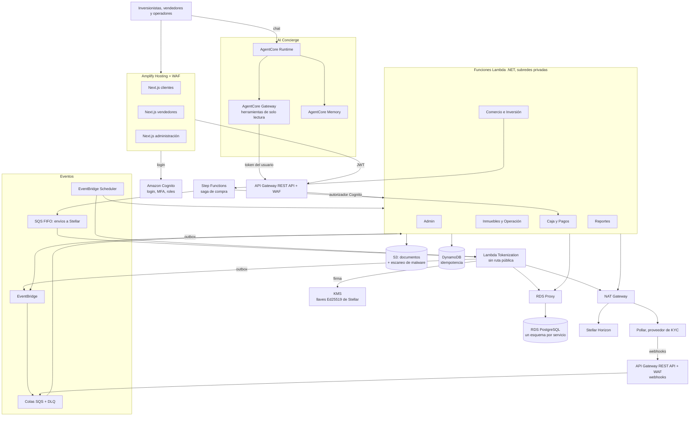

# Arquitectura del sistema: diseño en AWS con servicios administrados

| | |
|---|---|
| Estado | Borrador para revisión del equipo |
| Versión | 2.0, 2026-11-15 |
| Parte de | Diagrama general "AWS Cloud" del equipo |
| Documento relacionado | [metodos-de-valoracion-de-tokens-inmobiliarios.md](metodos-de-valoracion-de-tokens-inmobiliarios.md) (flujos de compra, cuentas de Stellar y cascada de distribución) |
| Alcance | MVP. La sección 13 lista los cambios necesarios antes de operar con fondos reales de inversionistas. |

## Cómo leer este documento

- La sección 1 describe el diseño actual y sus problemas.
- Las secciones 2 a 12 son el diseño propuesto. Cada problema del diseño actual tiene su solución en la sección indicada en la tabla 1.2.
- El criterio general es usar un servicio administrado de AWS cuando existe uno que resuelve el problema, en lugar de construirlo y operarlo.
- La sección 14 reúne las preguntas abiertas. Los puntos marcados **Por confirmar** dependen de ellas.
- Los costos son aproximados, en dólares por mes, con precios bajo demanda de us-east-1. En sa-east-1 (São Paulo) son entre 50% y 60% más altos. Deben confirmarse en la [calculadora de precios de AWS](https://calculator.aws/) antes de presupuestar.

## 0. Resumen

El diseño actual tiene dos aplicaciones Next.js, un gateway YARP en .NET, siete servicios .NET (cinco con su propia base PostgreSQL), una cola SQS y un asistente de IA en AgentCore. Las fronteras entre servicios son razonables y la arquitectura limpia del backend (repositorios, DTO, mapeadores, validación) se conserva sin cambios.

El diseño propuesto:

| Necesidad | Diseño actual | Diseño propuesto |
|---|---|---|
| Frontends | Next.js en contenedores Docker | **Amplify Hosting**, una app por frontend, con WAF |
| Entrada al backend | YARP en el puerto 5000 | **API Gateway REST API** con WAF |
| Identidad y login | Construida dentro del servicio Admin | **Amazon Cognito**, con MFA y grupos por rol |
| Servicios .NET | Contenedores en los puertos 8080 a 8085 | **AWS Lambda**, una función por servicio |
| Workers | Procesos .NET de larga duración | Funciones Lambda disparadas por **SQS** o **EventBridge Scheduler** |
| Base de datos | Una PostgreSQL por servicio | **Una instancia RDS for PostgreSQL** con un esquema por servicio, detrás de **RDS Proxy** |
| Documentos | Sin definir | **Amazon S3** cifrado, con escaneo de malware de **GuardDuty** |
| Eventos | SQS | **EventBridge** + **SQS** con DLQ, patrón outbox |
| Compra de fracciones | Sin coordinación | Saga en **AWS Step Functions** |
| Idempotencia | Sin definir | **Powertools for AWS Lambda (.NET)** con DynamoDB |
| Llaves de Stellar | Sin definir | **AWS KMS** con llaves Ed25519 |
| Consultas entre tenants | Servicio Global con acceso a todas las bases | Modelos de lectura en Reportes, alimentados por eventos |
| Asistente de IA | AgentCore + DynamoDB | **AgentCore Runtime, Gateway, Identity y Memory**, con **Bedrock Guardrails** |
| Observabilidad y auditoría | Sin definir | **CloudWatch**, **X-Ray**, **CloudTrail**, **GuardDuty** |
| Infraestructura | Sin definir | **AWS CDK** en C# |

El costo estimado de infraestructura del MVP va de unos $110 (mínimo) a $190 (recomendado) por mes (sección 12).

## 1. Diseño actual

### 1.1 Componentes

Esta tabla describe el diseño actual. La última columna indica qué lo reemplaza en el diseño propuesto.

| Componente | Tecnología actual | Puerto | Responsabilidad | En el diseño propuesto |
|---|---|---|---|---|
| App de clientes | Next.js (Node.js) | | Explorar activos, detalle del activo, registro y KYC, cargar saldo, comprar fracciones, portafolio y detalle de renta, mercado secundario, panel de administración | Amplify Hosting, sin el panel de administración (sección 3) |
| App de vendedores | Next.js (Node.js) | | Portal de vendedores | Amplify Hosting (sección 3) |
| Gateway | .NET con YARP | 5000 | Punto de entrada único para las dos apps y para AgentCore | **Se elimina.** Lo reemplaza API Gateway REST API con WAF (sección 4) |
| Global | .NET + worker | 8080 | Consultas a todas las bases de datos de los distintos tenants | **Se elimina.** Reportes asume su función con modelos de lectura (sección 6.4) |
| Admin | .NET + worker + PostgreSQL | 8080 | Multitenencia, identidad, clientes, planes y aprovisionamiento | Lambda. La identidad pasa a Cognito; Admin conserva tenants, planes, aprovisionamiento y KYC (sección 5) |
| Tokenization | .NET + PostgreSQL | 8081 | Emisión, transferencias y conciliación en cadena | Lambda sin ruta pública, alimentada por SQS FIFO (sección 8) |
| Inmuebles y Operación | .NET + PostgreSQL | 8082 | Inmuebles, contratos, documentos, avalúos y cierres mensuales | Lambda; documentos en S3 |
| Caja y Pagos | .NET + PostgreSQL | 8083 | Depósitos, retiros, reservas de saldo, libro mayor y conciliación | Lambda; también recibe las distribuciones de renta |
| Comercio e Inversión | .NET + PostgreSQL | 8084 | KYC, ofertas, órdenes, ejecuciones y distribuciones | Lambda; inicia la saga de compra en Step Functions |
| Reportes | .NET + worker | 8085 | Contenido e información para generar reportes | Lambda; absorbe a Global |
| AI Concierge | Python + DynamoDB, en AgentCore | | Asistente de inversión | AgentCore Runtime, Gateway, Identity y Memory (sección 10) |
| Mensajería | SQS | | Eventos entre Tokenization, Inmuebles y Operación, Caja y Pagos, y Comercio e Inversión | EventBridge + SQS con outbox y DLQ (sección 7) |
| Bases de datos | Una PostgreSQL por servicio | | | Una instancia RDS PostgreSQL, un esquema por servicio (sección 6) |

Hoy los contenedores se construyen con Docker. El repositorio tiene los proyectos `Adminstracion`, `Archivos`, `Expedientes` y `Gateway`, todos en .NET 10. El proyecto `Gateway` (YARP) deja de usarse con API Gateway. La relación entre los demás proyectos y los servicios del diagrama está en la sección 14.

### 1.2 Problemas del diseño actual y su solución

| # | Problema | Riesgo | Solución | Sección |
|---|---|---|---|---|
| O1 | Los navegadores llaman al gateway en `https://dominio:5000` y los servicios tienen puertos propios (8080 a 8085). No hay CDN, WAF ni balanceador en el borde. | Superficie de ataque amplia; nada filtra tráfico malicioso antes del código. | Amplify y API Gateway REST API, ambos con WAF. Los servicios no tienen dirección pública. | 3, 4 |
| O2 | El servicio Global consulta las bases de todos los tenants. | Rompe el aislamiento entre tenants. Una fuga en Global expone a todos. | Modelos de lectura en Reportes, alimentados por eventos. | 6.4 |
| O3 | El panel de administración vive dentro de la app de clientes. | Un error de autorización en la app de clientes puede dar acceso a funciones de administración. | App de administración separada, con MFA obligatorio y restricción por IP. | 3 |
| O4 | La identidad se construye dentro del servicio Admin. | Contraseñas, MFA, recuperación de cuentas y protección contra fuerza bruta son código propio y difícil de asegurar. | Amazon Cognito. | 5 |
| O5 | Las llaves de Stellar no tienen un lugar definido. | Una llave en disco o en una variable de entorno permite emitir o mover tokens. | AWS KMS con llaves Ed25519; la llave privada nunca sale de KMS. | 8.2 |
| O6 | AgentCore entra por el gateway y llega a Reportes sin límites definidos. | Un asistente con acceso amplio puede leer o ejecutar más de lo que debe. | AgentCore Gateway con herramientas de solo lectura y el token del propio inversionista. | 10 |
| O7 | La compra de fracciones cruza tres servicios y nada coordina los pasos ni los revierte. | Saldos reservados que nunca se liberan, o tokens entregados sin cobro registrado. | Saga en Step Functions. | 7.3 |
| O8 | SQS no tiene outbox, colas FIFO, idempotencia ni DLQ. | Eventos de dinero perdidos o duplicados. | Outbox, EventBridge, SQS FIFO donde importa el orden, DLQ e idempotencia con Powertools. | 7 |
| O9 | Faltan las entradas externas: webhooks de Pollar y del proveedor de KYC, y la lectura de eventos de Stellar Horizon. | Entradas públicas sin diseño de seguridad. | API de webhooks separada con WAF; lectura programada de Horizon. | 9 |
| O10 | El KYC está en Comercio e Inversión. | Mezcla cumplimiento con negociación. | El KYC pasa a Admin, junto al registro del cliente. | 5 |
| O11 | Las distribuciones de renta están en Comercio e Inversión. | El pago de rentas es trabajo del libro mayor y de la cadena. | Las distribuciones pasan a Caja y Pagos. | 4 |
| O12 | Hay una base PostgreSQL por servicio. | Cinco o más instancias cuestan mucho para un MVP. | Una instancia RDS con un esquema por servicio. | 6 |
| O13 | Los contratos, avalúos y documentos de KYC no tienen almacenamiento definido. | Documentos legales y datos personales sin cifrado ni control de acceso definidos. | S3 cifrado con KMS, URL prefirmadas y escaneo de malware. | 6.6 |
| O14 | No aparecen el cómputo, los secretos, la observabilidad, los respaldos ni la infraestructura como código. | Sin trazas ni respaldos no se puede auditar ni recuperar un libro mayor. | Lambda, Secrets Manager, CloudWatch, X-Ray, CloudTrail, respaldos de RDS y CDK. | 11 |
| O15 | Global y Reportes muestran un ícono verde con una "N" (parece Nginx). | Si es Nginx, sobra: el enrutamiento lo hace API Gateway. | Se elimina si es Nginx. | 14 |

## 2. Arquitectura propuesta

### 2.1 Vista general



### 2.2 Decisiones

| Tema | Decisión | Motivo |
|---|---|---|
| Frontends | Amplify Hosting, una app por frontend | Construye desde Git, despliega Next.js con SSR, incluye CDN, dominios, certificados y WAF integrado. |
| Entrada HTTP | API Gateway REST API | WAF solo protege las REST API de API Gateway, no las HTTP API. Incluye autorizador de Cognito, validación de solicitudes, límites de tasa y planes de uso. |
| Identidad | Amazon Cognito | MFA, recuperación de cuentas, protección contra fuerza bruta y emisión de JWT sin código propio. |
| Cómputo .NET | Lambda, una función por servicio | Con tráfico de MVP cuesta unos pocos dólares al mes. El código ASP.NET Core se conserva. |
| Workers | Lambda disparada por SQS o EventBridge Scheduler | Lambda no sostiene procesos largos y corta cada invocación a los 15 minutos. |
| Base de datos | Una instancia RDS for PostgreSQL, un esquema y un usuario por servicio | Mantiene las fronteras entre servicios con el costo de una sola instancia. |
| Conexiones | RDS Proxy con autenticación IAM | Absorbe los picos de conexiones de Lambda y elimina contraseñas de base de datos en las funciones. |
| Saga de compra | Step Functions (Standard) | Estado, reintentos, compensaciones y tiempos de espera administrados, con historial visible de cada compra. |
| Eventos | EventBridge para distribuir, SQS para consumir, outbox en cada servicio | Varios servicios necesitan el mismo evento; SQS solo entrega cada mensaje a un consumidor. |
| Idempotencia | Powertools for AWS Lambda (.NET) con una tabla DynamoDB | Utilidad administrada; evita escribir y probar la deduplicación en cada servicio. |
| Envíos a Stellar | SQS FIFO, un grupo de mensajes por cuenta firmante | Las transacciones de una misma cuenta necesitan números de secuencia en orden. |
| Llaves de Stellar | KMS con llaves `ECC_NIST_EDWARDS25519` | KMS firma Ed25519, el algoritmo de Stellar. La llave privada nunca sale de KMS. CloudHSM no hace falta. |
| Documentos | S3 con SSE-KMS, versionado y GuardDuty Malware Protection | Almacenamiento administrado; los archivos que suben los usuarios se escanean antes de usarse. |
| Asistente de IA | AgentCore Runtime, Gateway, Identity, Memory y Bedrock Guardrails | Hospedaje, herramientas, autenticación, memoria y filtros administrados. |
| Infraestructura | AWS CDK en C# | El equipo ya trabaja en .NET; un solo lenguaje para servicios e infraestructura. |

## 3. Frontends en Amplify Hosting

Cada frontend es una app de Amplify separada, conectada a su repositorio o carpeta en Git. Amplify construye en cada push, publica una URL de vista previa por rama y despliega Next.js con renderizado del lado del servidor.

| App | Usuarios | Dominio sugerido | WAF |
|---|---|---|---|
| Next.js clientes | Inversionistas | `app.dominio` | Sí: reglas administradas de AWS y límite de tasa por IP |
| Next.js vendedores | Vendedores de inmuebles | `vendedores.dominio` | Opcional en el MVP (sección 12) |
| Next.js administración | Operadores internos | `admin.dominio` | Sí: además, solo IPs de la oficina o de la VPN |

La app de administración es **nueva**: sale de la app de clientes (O3). Además de la restricción por IP, exige MFA y un usuario en el grupo de Cognito `operadores`, y llama a rutas propias de API Gateway (`/admin/*`).

Notas de Amplify:

- El WAF de Amplify cuesta $15 al mes por app, más el uso de WAF. Las reglas se crean en la región global de CloudFront (us-east-1).
- Las variables de entorno de cada rama apuntan al API Gateway del ambiente correspondiente (desarrollo, staging, producción).
- Los navegadores llaman directamente a API Gateway con el JWT de Cognito. Amplify no necesita acceso a la VPC.

## 4. API y servicios

API Gateway REST API enruta por prefijo de ruta. Los puertos 8080 a 8085 desaparecen y ningún servicio tiene dirección pública. Un autorizador de Cognito valida el JWT en cada solicitud antes de invocar la función.

| Servicio | Ruta | Responsabilidad | Esquema | Disparadores |
|---|---|---|---|---|
| Admin | `/admin/*`, `/tenants/*`, `/kyc/*` | Tenants, planes, aprovisionamiento, perfil del cliente y KYC (O10) | `admin` | HTTP, SQS (resultado del KYC), eventos de Cognito |
| Tokenization | Sin ruta pública | Emisión, transferencias y conciliación en cadena | `tokenization` | SQS FIFO, Scheduler |
| Inmuebles y Operación | `/properties/*` | Inmuebles, contratos, documentos, avalúos, cierres mensuales | `properties` | HTTP, Scheduler (cierre mensual) |
| Caja y Pagos | `/wallet/*` | Depósitos, retiros, reservas de saldo, libro mayor, conciliación y distribuciones de renta (O11) | `ledger` | HTTP, SQS, Step Functions, Scheduler |
| Comercio e Inversión | `/trading/*` | Ofertas, órdenes, ejecuciones, mercado secundario; inicia la saga de compra | `trading` | HTTP, Step Functions |
| Reportes | `/reports/*` | Reportes y modelos de lectura entre tenants; absorbe al servicio Global (O2) | `reporting` | HTTP, SQS (todos los eventos de dominio), Scheduler |

Tokenization no tiene ruta pública. Solo recibe instrucciones por su cola FIFO, así nadie puede pedirle una emisión o una transferencia desde internet.

Reglas de la API:

- WAF con las reglas administradas de AWS (conjunto común, entradas maliciosas conocidas, reputación de IP) y un límite de tasa por IP.
- Límites por método (throttling) y validación del cuerpo de las solicitudes con modelos JSON.
- Los permisos finos (qué tenant, qué recurso) los revisa cada servicio con los claims del JWT. El autorizador solo comprueba que el token sea válido.
- La integración con Lambda tiene un tiempo máximo de 29 segundos. Las operaciones largas (compras, reportes pesados) responden de inmediato con un identificador y el frontend consulta el estado.

## 5. Identidad con Amazon Cognito

Cognito reemplaza la identidad construida dentro de Admin (O4).

- **Un user pool** para inversionistas, vendedores y operadores, con grupos `inversionistas`, `vendedores` y `operadores`. Otra opción es un pool solo para operadores, que aísla las cuentas internas (**Por confirmar**, sección 14).
- **MFA** obligatorio para operadores y vendedores. Opcional para inversionistas en el MVP, obligatorio antes de retirar fondos.
- **Atributos personalizados** `tenant_id` y `kyc_status`. Un disparador *pre token generation* los copia al JWT para que los servicios no consulten Admin en cada solicitud.
- **Admin** sigue siendo dueño de tenants, planes, aprovisionamiento, el perfil del cliente y el KYC. Cuando el KYC se aprueba, Admin actualiza el atributo en Cognito.
- **Inicio de sesión** con la interfaz administrada de Cognito o con los formularios propios de Next.js usando la librería de Amplify. Cualquiera de las dos funciona con Amplify Hosting.
- **Costo**: el plan Essentials no cobra los primeros 10,000 usuarios activos al mes (confirmar en la página de precios de Cognito). La protección avanzada contra amenazas requiere el plan Plus, que cobra por usuario activo.

Si el servicio Admin ya emite tokens hoy, la migración a Cognito puede usar el disparador *user migration*, que importa a cada usuario la primera vez que inicia sesión.

## 6. Datos

### 6.1 Instancia

| Ambiente | Instancia | Costo aprox./mes | Notas |
|---|---|---|---|
| Desarrollo y staging | `db.t4g.micro`, single-AZ, 20 GB gp3 | ~$14 | Detenerla cuando no se use. RDS la reinicia sola a los 7 días. |
| Producción MVP | `db.t4g.small`, single-AZ, 20 GB gp3 | ~$26 | 2 GB de RAM, alrededor de 200 conexiones. |
| Producción con fondos reales | `db.t4g.small` o mayor, **Multi-AZ** | ~$52 o más | Conmutación automática. Ver sección 13. |

Alternativas evaluadas:

| Opción | Por qué no para el MVP |
|---|---|
| Aurora PostgreSQL | Demasiado caro para el MVP. |
| Aurora Serverless v2 con mínimo de 0 ACU | Se pausa sin tráfico, pero tarda varios segundos en despertar y una API lo nota. Con tráfico constante cuesta más que RDS. |
| Lightsail PostgreSQL (~$15) | Menos tamaños, peor integración con la VPC y un camino de crecimiento más difícil. |
| PostgreSQL en un contenedor | Respaldos, actualizaciones y recuperación a cargo del equipo. No es aceptable para un libro mayor. |

Pasar de RDS a Aurora más adelante se hace con una instantánea o una réplica de lectura. No requiere cambios de código.

### 6.2 RDS Proxy

Lambda escala lanzando copias, y cada copia abre sus propias conexiones. RDS Proxy mantiene un grupo de conexiones compartido y protege a la base de los picos.

- Cada función se conecta al proxy con **autenticación IAM**: no hay contraseñas de base de datos en las funciones ni en sus variables de entorno.
- El proxy obtiene las credenciales de cada usuario de base de datos desde Secrets Manager, con rotación automática.
- Costo: unos $22 al mes con un `db.t4g.small`. En desarrollo se puede omitir y conectar directo con un pool pequeño (`Maximum Pool Size=3`).

### 6.3 Un esquema y un usuario por servicio

- Cada servicio tiene su esquema y su usuario de base de datos. El usuario solo tiene permisos sobre su propio esquema.
- Ningún servicio lee el esquema de otro. Lo que necesita de otro servicio lo obtiene por API o por eventos.
- Las migraciones de EF Core de cada servicio solo tocan su esquema. Se ejecutan desde una función Lambda de migración en el despliegue, no al arrancar cada función.
- La contraseña maestra de RDS la administra RDS en Secrets Manager.

Así las fronteras entre servicios se mantienen y más adelante cualquier esquema se puede mover a su propia instancia.

### 6.4 Reemplazo del servicio Global

El servicio Global lee directamente las bases de todos los tenants (O2). En su lugar:

1. Cada servicio publica eventos de dominio (orden ejecutada, depósito acreditado, avalúo registrado, etc.).
2. Reportes consume esos eventos y arma sus propias tablas de lectura en el esquema `reporting`.
3. Las consultas entre tenants van a Reportes, que exige el grupo `operadores` y registra quién consultó qué.

Ningún servicio, además del dueño de cada esquema, tiene credenciales para leerlo.

### 6.5 Aislamiento entre tenants

Cada tabla con datos de un tenant tiene una columna `tenant_id` y una política de **Row-Level Security** de PostgreSQL. Al abrir la transacción, el servicio fija `app.tenant_id` con el valor del JWT y la base solo devuelve las filas de ese tenant, aunque una consulta olvide filtrar.

| Modelo | Aislamiento | Costo operativo |
|---|---|---|
| **Columna `tenant_id` con Row-Level Security (propuesto)** | Medio-alto. Lo aplica la base, no solo el código. | Bajo |
| Un esquema por tenant y por servicio | Alto | Las migraciones se multiplican por el número de tenants. |
| Una base por tenant | El más alto | El más alto. Encaja mal con una sola instancia pequeña. |

Si algún tenant exige aislamiento físico por contrato, se le puede dar una instancia propia más adelante (**Por confirmar**, sección 14).

### 6.6 Documentos en S3

Contratos, avalúos, documentos de inmuebles, documentos de KYC y reportes generados viven en S3 (O13).

- Un bucket por tipo de dato sensible (por ejemplo `documentos-inmuebles`, `kyc`, `reportes`), con bloqueo de acceso público, cifrado SSE-KMS con una llave por bucket y versionado.
- Los frontends suben y descargan con **URL prefirmadas** de corta duración que emite el servicio dueño. Los archivos no pasan por Lambda ni por API Gateway.
- **GuardDuty Malware Protection for S3** escanea cada archivo subido por usuarios. Los servicios solo procesan archivos con la etiqueta de escaneo limpio.
- Reglas de ciclo de vida para mover documentos antiguos a clases de almacenamiento más baratas. La retención de documentos legales y de KYC depende de la norma boliviana (**Asesoría legal**). Si la norma exige que no se puedan borrar, se activa **S3 Object Lock**.

El proyecto `Archivos` del repositorio probablemente corresponde a esta función (sección 14).

## 7. Eventos y consistencia

### 7.1 Patrón outbox

Cada servicio que publica eventos:

1. Guarda el cambio de negocio y el evento en una tabla `outbox` de su esquema, en la misma transacción.
2. Después de confirmar la transacción, intenta publicar el evento en EventBridge y lo marca como enviado.
3. Una función programada cada minuto con EventBridge Scheduler publica los eventos que quedaron pendientes.

Si el servicio cae entre guardar y publicar, el evento sigue en la tabla y se publica en el siguiente ciclo. Los consumidores son idempotentes, así que un evento publicado dos veces no causa daño.

### 7.2 Reglas de mensajería

- **EventBridge** distribuye cada evento a las colas de los servicios interesados, con reglas por tipo de evento.
- **SQS FIFO** donde importa el orden: movimientos del libro mayor por cuenta y envíos a Stellar por cuenta firmante.
- **Idempotencia** en todos los consumidores con la utilidad de idempotencia de Powertools for AWS Lambda (.NET), que guarda en DynamoDB los identificadores ya procesados y la respuesta que se dio.
- **DLQ** en todas las colas, con una alarma de CloudWatch cuando reciben mensajes.
- **Batch item failures** en los consumidores Lambda, para que un mensaje fallido no reintente todo el lote.
- **EventBridge archive** activado en el bus, para poder reproducir eventos después de corregir un error.

### 7.3 Saga de compra en Step Functions

La compra cruza tres servicios (O7). Comercio e Inversión crea la orden e inicia una ejecución de Step Functions con el identificador de la orden como nombre, así una misma orden no puede iniciar dos sagas.

| Paso | Servicio | Acción | Si falla |
|---|---|---|---|
| 1 | Comercio e Inversión | Crea la orden en estado `pendiente` e inicia la saga | Fin, sin efectos |
| 2 | Caja y Pagos | Reserva el saldo en USDC del inversionista | Orden `rechazada` |
| 3 | Tokenization | Recibe la instrucción por la cola FIFO con un *task token* y envía la transacción de Stellar: autorizar la trustline, USDC del inversionista al ESCROW, tokens de la DISTRIBUIDORA al inversionista, quitar la autorización | Caja y Pagos libera la reserva; orden `fallida` |
| 4 | Tokenization | Confirma la transacción en el ledger de Stellar y devuelve el resultado a Step Functions con el *task token* | Si no hay respuesta a tiempo, consulta Horizon por el hash antes de reintentar o revertir |
| 5 | Caja y Pagos | Convierte la reserva en un cargo en el libro mayor | Reintento idempotente; la conciliación diaria lo detecta |
| 6 | Comercio e Inversión | Marca la orden como `ejecutada` | Reintento idempotente |

- El paso 3 usa la integración `sqs:sendMessage.waitForTaskToken`: Step Functions espera sin costo mientras la cola FIFO mantiene el orden de los envíos a Stellar.
- El paso 4 nunca revierte a ciegas. Una transacción de Stellar sin respuesta puede haberse aplicado, así que primero se consulta por su hash.
- Cada paso tiene reintentos con espera exponencial y un tiempo máximo. Si se agotan, la saga ejecuta las compensaciones y deja la orden en `requiere revisión` con una alarma.
- La consola de Step Functions muestra el historial de cada compra, útil para soporte y auditoría.
- Costo: unas 10 transiciones por compra; con el precio de Standard ($0.025 por cada 1,000 transiciones) son unos $0.25 por cada 1,000 compras.

El flujo de compra completo está en la sección 3.3 de [metodos-de-valoracion-de-tokens-inmobiliarios.md](metodos-de-valoracion-de-tokens-inmobiliarios.md). La misma técnica sirve para retiros y para el pago mensual de rentas.

## 8. Tokenization y Stellar

### 8.1 Números de secuencia

Cada cuenta de Stellar acepta transacciones con números de secuencia en orden. Si dos copias de la función envían desde la misma cuenta al mismo tiempo, una falla con `tx_bad_seq`. Por eso:

- Todas las instrucciones de envío llegan por una cola **SQS FIFO**.
- El `MessageGroupId` es la cuenta firmante. SQS entrega en orden los mensajes de un grupo, uno a la vez.
- Cuentas firmantes distintas se procesan en paralelo.

### 8.2 Llaves en KMS

KMS soporta llaves `ECC_NIST_EDWARDS25519` y firma con el algoritmo `ED25519_SHA_512` (`MessageType: RAW`), que produce firmas Ed25519 como las de Stellar. Tokenization arma la transacción, calcula el hash que Stellar firma, pide la firma a KMS y la adjunta a la transacción. La llave privada nunca sale de KMS.

| Cuenta | Uso | Llave |
|---|---|---|
| Emisora (multifirma) | Emitir tokens, cambiar flags | Varias llaves KMS como firmantes; las operaciones de emisión requieren más de una firma |
| Llave de servicio de la emisora | Autorizar y quitar autorización de trustlines | Llave KMS |
| Distribuidora | Entregar tokens no vendidos | Llave KMS |
| Escrow | Recibir fondos de ventas | Llave KMS |
| Distribución | Pagar rentas en USDC | Llave KMS |
| Patrocinadora | Pagar comisiones de red | Llave KMS |

- La política de cada llave solo permite `kms:Sign` al rol de la función Tokenization, y la condición `kms:SigningAlgorithm` limita el algoritmo.
- Al menos un firmante de la cuenta emisora debe estar fuera de esta cuenta de AWS (otra cuenta de AWS o una llave física en manos de un responsable), para que una sola cuenta comprometida no pueda emitir tokens.
- Cada firma queda registrada en CloudTrail.
- Costo: $1 al mes por llave, más las solicitudes de firma.

## 9. Entradas externas

### 9.1 Webhooks de Pollar y del proveedor de KYC

- Entran por una REST API separada de API Gateway, en `hooks.dominio`, con su propio WAF y, si el proveedor publica sus IPs, una lista de IPs permitidas.
- Una función pequeña verifica la firma o el secreto compartido de cada proveedor, rechaza lo inválido y escribe el evento en SQS. No ejecuta lógica de negocio.
- El servicio dueño consume la cola: Caja y Pagos los eventos de Pollar y Admin los de KYC.

Responder rápido y procesar después evita que el proveedor reintente por tiempo de espera y genere duplicados.

### 9.2 Lectura de Stellar Horizon

Horizon no envía webhooks; el sistema lo lee.

- EventBridge Scheduler invoca a Tokenization cada minuto.
- Tokenization consulta las operaciones de las cuentas de la plataforma desde el último cursor guardado en su esquema, publica los eventos nuevos y guarda el nuevo cursor.
- La conciliación diaria compara los saldos en cadena con el libro mayor de Caja y Pagos y genera una alarma ante cualquier diferencia.

El streaming de Horizon necesita una conexión abierta que Lambda no sostiene. Si un minuto de retraso no alcanza, se evalúa un proveedor de indexación de Stellar (**Por confirmar**, sección 14).

## 10. AI Concierge en AgentCore

| Pieza | Uso |
|---|---|
| **AgentCore Runtime** | Hospeda el agente en Python. |
| **AgentCore Identity** | Valida el JWT de Cognito del inversionista (autenticación de entrada). |
| **AgentCore Gateway** | Expone como herramientas solo un subconjunto de lectura de la REST API (catálogo, detalle de activos, simulaciones, portafolio propio), a partir de su definición OpenAPI. WAF también puede proteger el Gateway. |
| **AgentCore Memory** | Guarda el historial y el contexto de cada conversación. Reemplaza la tabla DynamoDB del diseño actual. |
| **Bedrock Guardrails** | Filtra temas no permitidos, datos personales en las respuestas e intentos de manipular al agente. |

Reglas:

- Las herramientas llaman a la API con el token del propio inversionista, así el asistente solo ve los datos que el inversionista puede ver.
- Ninguna herramienta mueve dinero ni tokens. Si el asistente prepara una compra, el inversionista la confirma en la app y la orden sigue la saga normal.
- Los cálculos (NAV, rendimientos, proyecciones) los hace el backend, no el modelo de lenguaje, como indica el documento de valoración.

## 11. Operación

### 11.1 Lambda con .NET

El repositorio usa .NET 10, que Lambda soporta como runtime administrado. Cada servicio ASP.NET Core se convierte en función agregando el paquete `Amazon.Lambda.AspNetCoreServer.Hosting`:

```csharp
builder.Services.AddAWSLambdaHosting(LambdaEventSource.RestApi);
```

Los controladores, la inyección de dependencias y las capas de la arquitectura limpia no cambian. En local la app sigue corriendo como siempre.

**Arranque en frío.** Una app ASP.NET Core con EF Core puede tardar de 1 a 3 segundos en la primera solicitud después de estar inactiva.

| Opción | Efecto | Recomendación |
|---|---|---|
| SnapStart | Restaura una instantánea ya inicializada; suele dejar el arranque en unos cientos de milisegundos. Cobra por caché y restauración. | **Usar.** Requiere versiones publicadas y alias; API Gateway apunta al alias. |
| Native AOT | El arranque más rápido | No por ahora. El soporte de EF Core para AOT es limitado. |
| Provisioned concurrency | Elimina el arranque en frío, pero se paga todo el tiempo | No para el MVP. No se combina con SnapStart. |

Con SnapStart, el código que se ejecuta antes de la instantánea no debe guardar valores que tengan que ser únicos (semillas aleatorias, identificadores, conexiones abiertas). Las conexiones a la base se abren después de restaurar.

**Workers.**

| Worker actual | Reemplazo |
|---|---|
| Worker de Admin | Funciones disparadas por SQS (aprovisionamiento, resultados de KYC) |
| Worker de Reportes | Función disparada por SQS (modelos de lectura) y EventBridge Scheduler (reportes periódicos) |
| Worker de Global | Desaparece junto con el servicio (sección 6.4) |
| Cierre mensual, conciliación, pago de rentas | EventBridge Scheduler que inicia una ejecución de Step Functions |

Un trabajo que pueda pasar de 15 minutos se divide en pasos de Step Functions o en lotes encadenados por SQS.

### 11.2 Red

- Las funciones que usan RDS corren en subredes privadas de la VPC.
- Para llamar a Stellar Horizon, Pollar o el proveedor de KYC necesitan un **NAT Gateway** (~$32 al mes más transferencia de datos).
- **VPC endpoints** de tipo gateway para S3 y DynamoDB, gratuitos, para que ese tráfico no pase por el NAT.
- **VPC endpoints** de tipo interfaz para KMS, SQS, EventBridge y Secrets Manager cuestan unos $7 al mes cada uno por zona de disponibilidad. Para el MVP ese tráfico puede ir por el NAT; se agregan cuando el volumen lo justifique.

### 11.3 Observabilidad, seguridad y respaldos

| Tema | Propuesta |
|---|---|
| Logs | Powertools Logging en JSON hacia CloudWatch Logs, con retención definida (por ejemplo 30 días) |
| Trazas | Powertools Tracing con X-Ray. API Gateway genera un ID de correlación que viaja por las llamadas, los eventos y Step Functions. |
| Métricas y alarmas | Powertools Metrics; alarmas por errores y duración de funciones, mensajes en DLQ, sagas en `requiere revisión`, conexiones de RDS, saldos de las cuentas de Stellar y diferencias de conciliación |
| Secretos | Secrets Manager para credenciales de proveedores externos; RDS Proxy con IAM para la base; KMS para llaves de Stellar |
| Respaldos | Respaldos automáticos de RDS con 7 a 14 días de retención y restauración a un punto en el tiempo; **AWS Backup** para copias en otra región antes de producción |
| Auditoría | CloudTrail en todas las regiones, con los logs en un bucket S3 protegido |
| Detección de amenazas | GuardDuty en la cuenta, incluido el escaneo de malware de S3 |
| Infraestructura como código | AWS CDK en C#, un stack por servicio más uno compartido (red, base de datos, bus de eventos). Las apps de Amplify se conectan a Git y se definen también en CDK. |
| Despliegue | Un pipeline por servicio (GitHub Actions o CodePipeline) que compila, prueba y ejecuta `cdk deploy`; las migraciones de base de datos corren antes de publicar la nueva versión |

## 12. Costo estimado del MVP

Precios aproximados de us-east-1, con tráfico bajo. La columna "Mínimo" omite lo que puede esperar hasta tener fondos reales.

| Componente | Mínimo | Recomendado | Notas |
|---|---|---|---|
| Amplify Hosting (3 apps) | $5 | $15 | Compilación, almacenamiento, datos servidos y SSR. Tiene capa gratuita. |
| WAF en Amplify | $15 | $30 | $15 por app: clientes y administración; vendedores opcional |
| API Gateway REST API | $1 | $5 | ~$3.50 por millón de solicitudes |
| WAF (reglas y solicitudes) | $10 | $15 | Dos web ACL: una global para Amplify y una regional para las APIs |
| Cognito | $0 | $0 | Plan Essentials, hasta 10,000 usuarios activos al mes |
| Lambda | $0 | $5 | A menudo dentro de la capa gratuita |
| Step Functions | $0 | $1 | |
| RDS PostgreSQL `db.t4g.small` | $26 | $26 | Single-AZ, 20 GB |
| RDS Proxy | $0 | $22 | Omitible al inicio con pools pequeños |
| NAT Gateway | $32 | $32 | Más transferencia de datos |
| SQS, EventBridge, Scheduler | $1 | $2 | |
| DynamoDB (idempotencia) | $0 | $1 | Bajo demanda |
| S3 | $1 | $3 | |
| KMS | $8 | $10 | 6 llaves de Stellar y llaves de S3 |
| Secrets Manager | $2 | $3 | Pocos secretos gracias a la autenticación IAM |
| CloudWatch y X-Ray | $5 | $10 | |
| GuardDuty | $5 | $10 | Depende del volumen de eventos y archivos |
| **Total** | **~$110** | **~$190** | |

No incluye AgentCore ni el modelo de lenguaje, que se cobran por uso, ni dominios y transferencia de datos a internet.

## 13. Antes de operar con fondos reales

- RDS en Multi-AZ, RDS Proxy activo y copias de respaldo en otra región con AWS Backup.
- Pruebas de restauración de la base, documentadas.
- Firmantes de la cuenta emisora en lugares distintos (sección 8.2).
- MFA obligatorio para inversionistas antes de retirar fondos.
- WAF en las tres apps de Amplify.
- Cuentas de AWS separadas para desarrollo, staging y producción con **AWS Organizations** (o **Control Tower**), y **IAM Identity Center** para el acceso del equipo.
- **Security Hub** activado para revisar la configuración contra buenas prácticas.
- Revisión de seguridad del panel de administración, los webhooks y las políticas de KMS.

## 14. Preguntas abiertas

| # | Pregunta | Afecta a |
|---|---|---|
| P1 | ¿Qué es el ícono verde con una "N" en Global y Reportes? Si es Nginx, ¿para qué se usa? | Sección 1.2 |
| P2 | ¿Cómo se relacionan los proyectos del repositorio (`Adminstracion`, `Archivos`, `Expedientes`) con los servicios del diagrama? | Secciones 1 y 4 |
| P3 | ¿Se aceptan los cambios de frontera: KYC a Admin, distribuciones a Caja y Pagos, Global absorbido por Reportes? | Secciones 4 y 6.4 |
| P4 | ¿Un solo user pool de Cognito con grupos, o un pool separado para operadores? | Sección 5 |
| P5 | ¿Algún tenant necesita aislamiento físico de datos por contrato? | Sección 6.5 |
| P6 | ¿Qué plazos de retención exige la norma boliviana para contratos, avalúos y documentos de KYC? (**Asesoría legal**) | Sección 6.6 |
| P7 | ¿Basta un minuto de retraso al leer Horizon, o hace falta un proveedor de indexación? | Sección 9.2 |
| P8 | ¿Quién custodia el firmante externo de la cuenta emisora? | Sección 8.2 |
| P9 | ¿En qué región se despliega: us-east-1 o sa-east-1? Confirmar que AgentCore y los demás servicios estén disponibles en la región elegida. | Secciones 10 y 12 |
| P10 | ¿GitHub Actions o CodePipeline para los despliegues? | Sección 11.3 |
