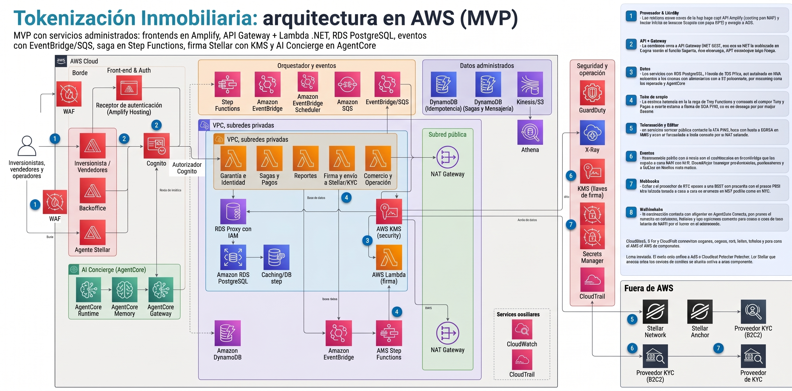
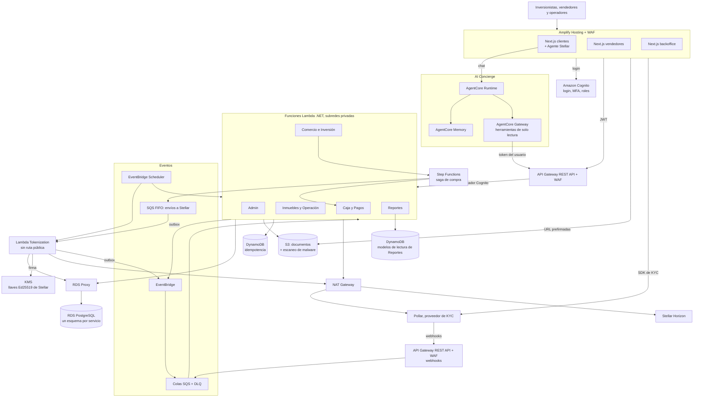
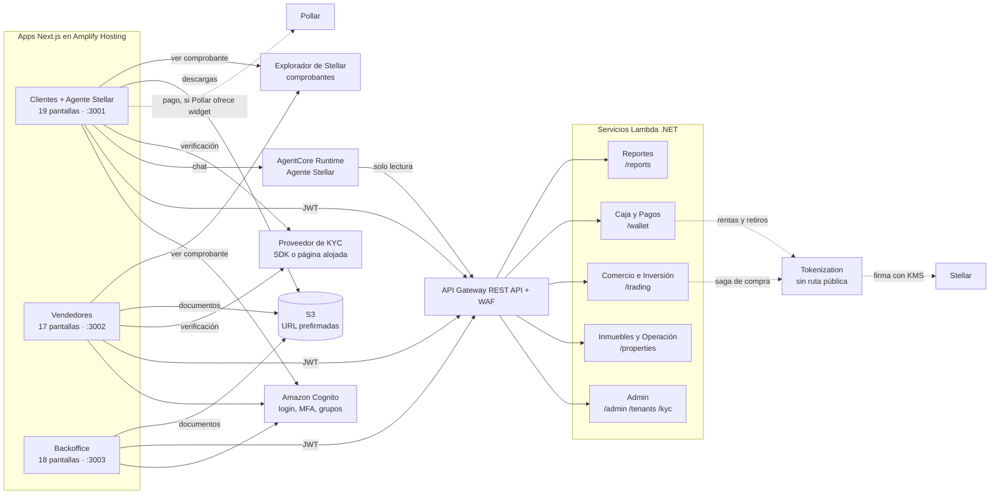

# Arquitectura del sistema: diseño en AWS con servicios administrados

| | |
|---|---|
| Estado | Borrador para revisión del equipo |
| Versión | 2.3, 2026-11-18 |
| Parte de | Diagrama general "AWS Cloud" del equipo |
| Documento relacionado | [metodos-de-valoracion-de-tokens-inmobiliarios.md](metodos-de-valoracion-de-tokens-inmobiliarios.md) (flujos de compra, cuentas de Stellar y cascada de distribución) |
| Alcance | MVP. La sección 13 lista los cambios necesarios antes de operar con fondos reales de inversionistas. |

## Cómo leer este documento

- La sección 1 describe el diseño actual y sus problemas.
- Las secciones 2 a 12 son el diseño propuesto. Cada problema del diseño actual tiene su solución en la sección indicada en la tabla 1.2.
- El criterio general es usar un servicio administrado de AWS cuando existe uno que resuelve el problema, en lugar de construirlo y operarlo.
- La sección 14 reúne las preguntas abiertas. Los puntos marcados **Por confirmar** dependen de ellas.
- Los costos son aproximados, en dólares por mes, con precios bajo demanda de us-east-1. En sa-east-1 (São Paulo) son entre 50% y 60% más altos. Deben confirmarse en la [calculadora de precios de AWS](https://calculator.aws/) antes de presupuestar.

## 0. Resumen

El diseño actual tiene dos aplicaciones Next.js, un gateway YARP en .NET, siete servicios .NET (cinco con su propia base PostgreSQL y dos, Global y Reportes, con MongoDB), una cola SQS y un asistente de IA en AgentCore. Las fronteras entre servicios son razonables y la arquitectura limpia del backend (repositorios, DTO, mapeadores, validación) se conserva sin cambios.

El diseño propuesto:

| Necesidad | Diseño actual | Diseño propuesto |
|---|---|---|
| Frontends | Next.js en contenedores Docker | **Amplify Hosting**, tres apps Next.js separadas en un monorepo (clientes con el Agente Stellar, vendedores y backoffice), con WAF; 54 pantallas en total |
| Entrada al backend | YARP en el puerto 5000 | **API Gateway REST API** con WAF |
| Identidad y login | Construida dentro del servicio Admin | **Amazon Cognito**, con MFA y grupos por rol |
| Servicios .NET | Contenedores en los puertos 8080 a 8085 | **AWS Lambda**, una función por servicio |
| Workers | Procesos .NET de larga duración | Funciones Lambda disparadas por **SQS** o **EventBridge Scheduler** |
| Base de datos | Una PostgreSQL por servicio; MongoDB en Global y Reportes | **Una instancia RDS for PostgreSQL** con un esquema por servicio, detrás de **RDS Proxy**; **DynamoDB** para los modelos de lectura de Reportes |
| Documentos | Sin definir | **Amazon S3** cifrado, con escaneo de malware de **GuardDuty** |
| Eventos | SQS | **EventBridge** + **SQS** con DLQ, patrón outbox |
| Compra de fracciones | Sin coordinación | Saga en **AWS Step Functions** |
| Idempotencia | Sin definir | **Powertools for AWS Lambda (.NET)** con DynamoDB |
| Llaves de Stellar | Sin definir | **AWS KMS** con llaves Ed25519 |
| Consultas entre tenants | Servicio Global con acceso a todas las bases | Modelos de lectura de Reportes en DynamoDB, alimentados por eventos |
| Asistente de IA | AgentCore + DynamoDB | **AgentCore Runtime, Gateway, Identity y Memory**, con **Bedrock Guardrails** |
| Observabilidad y auditoría | Sin definir | **CloudWatch**, **X-Ray**, **CloudTrail**, **GuardDuty** |
| Infraestructura | Sin definir | **AWS CDK** en C# |

El costo estimado de infraestructura del MVP va de unos $110 (mínimo) a $190 (recomendado) por mes (sección 12).

## 1. Diseño actual

### 1.1 Componentes

Esta tabla describe el diseño actual. La última columna indica qué lo reemplaza en el diseño propuesto.

| Componente | Tecnología actual | Puerto | Responsabilidad | En el diseño propuesto |
|---|---|---|---|---|
| App de clientes | Next.js (Node.js) | | Explorar activos, detalle del activo, registro y KYC, cargar saldo, comprar fracciones, portafolio y detalle de renta, mercado secundario, panel de administración | Amplify Hosting, proyecto `apps/clientes`, puerto local **3001**. Sin el panel de administración e incluye el Agente Stellar (sección 3) |
| App de vendedores | Next.js (Node.js) | | Portal de vendedores | Amplify Hosting, proyecto `apps/vendedores`, puerto local **3002** (sección 3) |
| Backoffice | No existe; vive dentro de la app de clientes | | Panel de operadores | **Nuevo.** Amplify Hosting, proyecto `apps/backoffice`, puerto local **3003**, con MFA y restricción por IP (sección 3, O3) |
| Gateway | .NET con YARP | 5000 | Punto de entrada único para las dos apps y para AgentCore | **Se elimina.** Lo reemplaza API Gateway REST API con WAF (sección 4) |
| Global | .NET + worker + MongoDB | 8080 | Consultas a todas las bases de datos de los distintos tenants | **Se elimina.** Reportes asume su función con modelos de lectura (sección 6.4) |
| Admin | .NET + worker + PostgreSQL | 8080 | Multitenencia, identidad, clientes, planes y aprovisionamiento | Lambda. La identidad pasa a Cognito; Admin conserva tenants, planes, aprovisionamiento y KYC (sección 5) |
| Tokenization | .NET + PostgreSQL | 8081 | Emisión, transferencias y conciliación en cadena | Lambda sin ruta pública, alimentada por SQS FIFO (sección 8) |
| Inmuebles y Operación | .NET + PostgreSQL | 8082 | Inmuebles, contratos, documentos, avalúos y cierres mensuales | Lambda; documentos en S3 |
| Caja y Pagos | .NET + PostgreSQL | 8083 | Depósitos, retiros, reservas de saldo, libro mayor y conciliación | Lambda; también recibe las distribuciones de renta |
| Comercio e Inversión | .NET + PostgreSQL | 8084 | KYC, ofertas, órdenes, ejecuciones y distribuciones | Lambda; inicia la saga de compra en Step Functions |
| Reportes | .NET + worker + MongoDB | 8085 | Contenido e información para generar reportes | Lambda con DynamoDB en lugar de MongoDB; absorbe a Global (sección 6.5) |
| AI Concierge | Python + DynamoDB, en AgentCore | | Asistente de inversión | AgentCore Runtime, Gateway, Identity y Memory (sección 10). En el front es el Agente Stellar, paquete de la app de clientes (sección 3.9) |
| Mensajería | SQS | | Eventos entre Tokenization, Inmuebles y Operación, Caja y Pagos, y Comercio e Inversión | EventBridge + SQS con outbox y DLQ (sección 7) |
| Bases de datos | Una PostgreSQL por servicio; MongoDB en Global y Reportes | | | Una instancia RDS PostgreSQL, un esquema por servicio; DynamoDB para Reportes (sección 6) |

Hoy los contenedores se construyen con Docker. El repositorio tiene los proyectos `Adminstracion`, `Archivos`, `Expedientes` y `Gateway`, todos en .NET 10. El proyecto `Gateway` (YARP) deja de usarse con API Gateway. La relación entre los demás proyectos y los servicios del diagrama está en la sección 14.

### 1.2 Problemas del diseño actual y su solución

| # | Problema | Riesgo | Solución | Sección |
|---|---|---|---|---|
| O1 | Los navegadores llaman al gateway en `https://dominio:5000` y los servicios tienen puertos propios (8080 a 8085). No hay CDN, WAF ni balanceador en el borde. | Superficie de ataque amplia; nada filtra tráfico malicioso antes del código. | Amplify y API Gateway REST API, ambos con WAF. Los servicios no tienen dirección pública. | 3, 4 |
| O2 | El servicio Global consulta las bases de todos los tenants. | Rompe el aislamiento entre tenants. Una fuga en Global expone a todos. | Modelos de lectura en Reportes, alimentados por eventos. | 6.4 |
| O3 | El panel de administración vive dentro de la app de clientes. | Un error de autorización en la app de clientes puede dar acceso a funciones de administración. | App de administración separada, con MFA obligatorio y restricción por IP. | 3 |
| O4 | La identidad se construye dentro del servicio Admin. | Contraseñas, MFA, recuperación de cuentas y protección contra fuerza bruta son código propio y difícil de asegurar. | Amazon Cognito. | 5 |
| O5 | Las llaves de Stellar no tienen un lugar definido. | Una llave en disco o en una variable de entorno permite emitir o mover tokens. | AWS KMS con llaves Ed25519; la llave privada nunca sale de KMS. | 8.2 |
| O6 | AgentCore entra por el gateway y llega a Reportes sin límites definidos. | Un asistente con acceso amplio puede leer o ejecutar más de lo que debe. | AgentCore Gateway con herramientas de solo lectura y el token del propio inversionista. | 10 |
| O7 | La compra de fracciones cruza tres servicios y nada coordina los pasos ni los revierte. | Saldos reservados que nunca se liberan, o tokens entregados sin cobro registrado. | Saga en Step Functions. | 7.3 |
| O8 | SQS no tiene outbox, colas FIFO, idempotencia ni DLQ. | Eventos de dinero perdidos o duplicados. | Outbox, EventBridge, SQS FIFO donde importa el orden, DLQ e idempotencia con Powertools. | 7 |
| O9 | Faltan las entradas externas: webhooks de Pollar y del proveedor de KYC, y la lectura de eventos de Stellar Horizon. | Entradas públicas sin diseño de seguridad. | API de webhooks separada con WAF; lectura programada de Horizon. | 9 |
| O10 | El KYC está en Comercio e Inversión. | Mezcla cumplimiento con negociación. | El KYC pasa a Admin, junto al registro del cliente. | 5 |
| O11 | Las distribuciones de renta están en Comercio e Inversión. | El pago de rentas es trabajo del libro mayor y de la cadena. | Las distribuciones pasan a Caja y Pagos. | 4 |
| O12 | Hay una base PostgreSQL por servicio. | Cinco o más instancias cuestan mucho para un MVP. | Una instancia RDS con un esquema por servicio. | 6 |
| O13 | Los contratos, avalúos y documentos de KYC no tienen almacenamiento definido. | Documentos legales y datos personales sin cifrado ni control de acceso definidos. | S3 cifrado con KMS, URL prefirmadas y escaneo de malware. | 6.7 |
| O14 | No aparecen el cómputo, los secretos, la observabilidad, los respaldos ni la infraestructura como código. | Sin trazas ni respaldos no se puede auditar ni recuperar un libro mayor. | Lambda, Secrets Manager, CloudWatch, X-Ray, CloudTrail, respaldos de RDS y CDK. | 11 |
| O15 | Global y Reportes usan MongoDB. | Una base más para operar, respaldar y asegurar, fuera de los servicios administrados de AWS. | DynamoDB para los modelos de lectura de Reportes; Global desaparece. | 6.5 |

## 2. Arquitectura propuesta

### 2.1 Vista general

Diagrama con los íconos oficiales de AWS. Se genera con [img/arquitectura-aws.py](img/arquitectura-aws.py) (`uv run --with diagrams python docs/img/arquitectura-aws.py`, requiere Graphviz); hay que regenerarlo cuando cambie el diseño.



El mismo diseño en Mermaid, editable directamente en este documento:



### 2.2 Decisiones

| Tema | Decisión | Motivo |
|---|---|---|
| Frontends | Amplify Hosting, una app por frontend | Construye desde Git, despliega Next.js con SSR, incluye CDN, dominios, certificados y WAF integrado. |
| Entrada HTTP | API Gateway REST API | WAF solo protege las REST API de API Gateway, no las HTTP API. Incluye autorizador de Cognito, validación de solicitudes, límites de tasa y planes de uso. |
| Identidad | Amazon Cognito | MFA, recuperación de cuentas, protección contra fuerza bruta y emisión de JWT sin código propio. |
| Cómputo .NET | Lambda, una función por servicio | Con tráfico de MVP cuesta unos pocos dólares al mes. El código ASP.NET Core se conserva. |
| Workers | Lambda disparada por SQS o EventBridge Scheduler | Lambda no sostiene procesos largos y corta cada invocación a los 15 minutos. |
| Base de datos | Una instancia RDS for PostgreSQL, un esquema y un usuario por servicio | Mantiene las fronteras entre servicios con el costo de una sola instancia. |
| Modelos de lectura de Reportes | DynamoDB bajo demanda, en lugar de MongoDB | Sin servidores que operar, cobra por uso y escala solo. Los datos de lectura se arman desde eventos, un patrón que DynamoDB resuelve bien. |
| Conexiones | RDS Proxy con autenticación IAM | Absorbe los picos de conexiones de Lambda y elimina contraseñas de base de datos en las funciones. |
| Saga de compra | Step Functions (Standard) | Estado, reintentos, compensaciones y tiempos de espera administrados, con historial visible de cada compra. |
| Eventos | EventBridge para distribuir, SQS para consumir, outbox en cada servicio | Varios servicios necesitan el mismo evento; SQS solo entrega cada mensaje a un consumidor. |
| Idempotencia | Powertools for AWS Lambda (.NET) con una tabla DynamoDB | Utilidad administrada; evita escribir y probar la deduplicación en cada servicio. |
| Envíos a Stellar | SQS FIFO, un grupo de mensajes por cuenta firmante | Las transacciones de una misma cuenta necesitan números de secuencia en orden. |
| Llaves de Stellar | KMS con llaves `ECC_NIST_EDWARDS25519` | KMS firma Ed25519, el algoritmo de Stellar. La llave privada nunca sale de KMS. CloudHSM no hace falta. |
| Documentos | S3 con SSE-KMS, versionado y GuardDuty Malware Protection | Almacenamiento administrado; los archivos que suben los usuarios se escanean antes de usarse. |
| Asistente de IA | AgentCore Runtime, Gateway, Identity, Memory y Bedrock Guardrails | Hospedaje, herramientas, autenticación, memoria y filtros administrados. |
| Infraestructura | AWS CDK en C# | El equipo ya trabaja en .NET; un solo lenguaje para servicios e infraestructura. |

## 3. Frontends en Amplify Hosting

El sistema tiene tres aplicaciones Next.js, una por tipo de usuario. Cada una es una app separada de Amplify Hosting, con su dominio, su WAF y su grupo de Cognito. Comparten código en un monorepo (sección 3.2), pero se despliegan y protegen por separado. Así un error en una app no expone las funciones de otra (O3).

### 3.1 Las tres apps

| App | Usuarios | Grupo de Cognito | Dominio sugerido | Puerto local | Rutas de API que usa | Pantallas | WAF |
|---|---|---|---|---|---|---|---|
| Next.js clientes (incluye el Agente Stellar) | Inversionistas | `inversionistas` | `app.dominio` | 3001 | `/properties/*` (lectura), `/kyc/*`, `/wallet/*`, `/trading/*`, `/reports/*` (solo datos propios) y AgentCore | 19 | Sí: reglas administradas de AWS y límite de tasa por IP |
| Next.js vendedores | Vendedores de inmuebles | `vendedores` | `vendedores.dominio` | 3002 | `/properties/*`, `/kyc/*` (verificación de la empresa), `/trading/*` (lectura de sus ofertas), `/wallet/*` (sus cobros), `/reports/*` (solo datos propios) | 17 | Opcional en el MVP (sección 12) |
| Next.js backoffice | Operadores internos | `operadores` | `admin.dominio` | 3003 | `/admin/*`, `/tenants/*` y las funciones de operador de los demás servicios | 18 | Sí: además, solo IPs de la oficina o de la VPN |

**Total: 54 pantallas.** Las tres apps son proyectos separados, cada uno en su carpeta y con su propio despliegue (sección 3.2). El Agente Stellar no es una cuarta app: es un paquete que solo usa la app de clientes (sección 3.9). Los puertos locales aplican solo en desarrollo. Las secciones 3.10 a 3.12 detallan las pantallas, la 3.17 muestra el mapa de integraciones y la 3.18 los servicios que usa cada pantalla.

El backoffice (la app de administración) es **nuevo**: sale de la app de clientes (O3). Además de la restricción por IP, exige MFA y un usuario en el grupo `operadores`, y llama a rutas propias de API Gateway (`/admin/*`). Las funciones de operador de otros servicios (aprobar distribuciones, revisar sagas, conciliar) revisan el grupo `operadores` en el JWT.

### 3.2 Stack y organización del código

| Tema | Decisión | Motivo |
|---|---|---|
| Framework | Next.js con App Router y TypeScript, en una versión que soporte Amplify Hosting (**Por confirmar**, P14) | SSR, ISR y middleware soportados por Amplify |
| Repositorio | **Monorepo** con pnpm workspaces y Turborepo: tres apps separadas (`apps/clientes`, `apps/vendedores`, `apps/backoffice`) y paquetes compartidos, entre ellos `agente-stellar` | Amplify soporta monorepos con una carpeta raíz por app (`appRoot`) |
| Paquete `ui` | Tailwind CSS + shadcn/ui, con los tokens de diseño de la marca | Un solo sistema visual en las tres apps |
| Paquete `api-client` | Tipos y cliente generados desde la definición OpenAPI de la REST API (`openapi-typescript` u otro generador) | Front y back comparten el contrato; un cambio en la API rompe la compilación, no la producción |
| Paquete `auth` | Configuración de Amplify Auth, middleware y utilidades de grupos y claims | La misma lógica de sesión en las tres apps |
| Paquete `config` | ESLint, TypeScript y Tailwind compartidos | Mismas reglas en todo el código |
| Datos del servidor | TanStack Query | Caché, reintentos, invalidación y consulta periódica de estados |
| Formularios | React Hook Form + Zod | Validación en el cliente con los mismos esquemas que espera la API |
| Estado global | Solo la sesión y preferencias de la interfaz | El resto vive en TanStack Query |
| Idioma y formato | Español, montos con `Intl.NumberFormat` (USD y Bs), fechas en la zona `America/La_Paz` | Coherencia en montos y fechas de rentas |

```
plataforma-frontend/
├── apps/
│   ├── clientes/             app.dominio · puerto local 3001 · incluye el Agente Stellar
│   ├── vendedores/           vendedores.dominio · puerto local 3002
│   └── backoffice/           admin.dominio · puerto local 3003
├── packages/
│   ├── agente-stellar/       asistente de IA (solo lo usa clientes)
│   ├── ui/                   componentes y tokens de diseño
│   ├── api-client/           cliente y tipos generados desde OpenAPI
│   ├── auth/                 Amplify Auth, MFA, middleware por grupo
│   ├── stellar/              formato de montos y enlaces al explorador
│   └── config/               ESLint, TypeScript, Tailwind
├── amplify.yml               build de las tres apps
├── pnpm-workspace.yaml
├── turbo.json
└── package.json
```

Dentro de cada app, el código se organiza por funcionalidad (`features/catalogo`, `features/compra`, `features/billetera`…). Las pantallas solo componen; la lógica de cada funcionalidad vive en su carpeta. Cada paquete compartido se publica en el workspace como `@plataforma/<nombre>` y las apps lo declaran con `"workspace:*"` y en `transpilePackages` de `next.config.ts`.

**`apps/clientes`** (C1 a C19 y el Agente Stellar)

```
apps/clientes/src/
├── app/
│   ├── (publico)/                  page.tsx C1 · activos/ C2 · activos/[id]/ C3
│   ├── (auth)/                     registro/ C4 · ingresar/ C5 · recuperar/ C6
│   └── (app)/                      solo grupo inversionistas
│       ├── layout.tsx              navegación inferior + botón del Agente Stellar
│       ├── verificacion/           C7
│       ├── billetera/              C8 · depositar/ C9 · retirar/ C10
│       ├── activos/[id]/comprar/   C11 (acepta datos precargados por el agente)
│       ├── ordenes/                C13 · [id]/ C12
│       ├── portafolio/             C14 · [activoId]/ C15
│       ├── mercado/                C16 · vender/ C17
│       ├── reportes/               C18
│       ├── cuenta/                 C19
│       └── asistente/              Agente Stellar a pantalla completa
├── features/                       catalogo/ compra/ billetera/ portafolio/ mercado/
├── middleware.ts                   sesión y grupo inversionistas en (app)
└── next.config.ts
```

**`apps/vendedores`** (V1 a V17)

```
apps/vendedores/src/
├── app/
│   ├── (auth)/                     ingresar/ V1 · registro/ V2 · seguridad/ V3
│   └── (portal)/                   solo grupo vendedores, con MFA
│       ├── layout.tsx              menú lateral
│       ├── page.tsx                V5
│       ├── verificacion/           V4
│       ├── inmuebles/              V6 · nuevo/ V7 · [id]/ V8
│       │   └── [id]/               documentos/ V9 · avaluos/ V10 · oferta/ V11 · oferta/avance/ V12 · operacion/ V13 · distribuciones/ V14
│       ├── cobros/                 V15
│       ├── reportes/               V16
│       └── cuenta/                 V17
├── features/                       inmuebles/ oferta/ operacion/ cobros/
└── middleware.ts                   grupo vendedores y MFA
```

**`apps/backoffice`** (A1 a A18)

```
apps/backoffice/src/
├── app/
│   ├── ingresar/                   A1
│   └── (panel)/                    solo grupo operadores, MFA y WAF por IP
│       ├── layout.tsx              menú lateral
│       ├── page.tsx                A2
│       ├── tenants/                A3 · [id]/ A4
│       ├── usuarios/               A5
│       ├── verificaciones/         A6 · [id]/ A7
│       ├── inmuebles/              A8 · [id]/ A9 · [id]/avaluos/ A10 · [id]/emision/ A11
│       ├── cierres/                A12
│       ├── distribuciones/         A13
│       ├── ordenes/                A14
│       ├── tesoreria/              A15
│       ├── conciliacion/           A16
│       ├── reportes/               A17
│       └── auditoria/              A18
├── features/                       verificaciones/ inmuebles/ distribuciones/ tesoreria/
└── middleware.ts                   grupo operadores y MFA
```

**`packages/agente-stellar`**

```
packages/agente-stellar/src/
├── components/
│   ├── BotonAsistente.tsx          botón flotante en las pantallas privadas
│   ├── PanelChat.tsx               mensajes, sugerencias y campo de texto
│   └── TarjetaAccion.tsx           lleva a la compra con datos precargados
├── hooks/useAgente.ts              estado de la conversación y streaming
├── lib/agentcore.ts                llamada a AgentCore Runtime con el token del usuario
├── sugerencias.ts                  preguntas iniciales
└── index.ts
```

**Desarrollo local y puertos**

Cada app corre en su propio puerto en desarrollo. En Amplify no hay puertos: cada app se publica en su dominio.

| App | Carpeta | Puerto local | URL local | Comando |
|---|---|---|---|---|
| Clientes (con el Agente Stellar) | `apps/clientes` | 3001 | `http://localhost:3001` | `pnpm --filter clientes dev` |
| Vendedores | `apps/vendedores` | 3002 | `http://localhost:3002` | `pnpm --filter vendedores dev` |
| Backoffice | `apps/backoffice` | 3003 | `http://localhost:3003` | `pnpm --filter backoffice dev` |

```json
// apps/clientes/package.json      (vendedores: 3002 · backoffice: 3003)
"scripts": {
  "dev": "next dev -p 3001",
  "start": "next start -p 3001"
}
```

`pnpm turbo dev` en la raíz levanta las tres apps a la vez. Para que el desarrollo local funcione:

- El app client de Cognito de cada app incluye su URL local en las URL de retorno y de cierre de sesión (`http://localhost:3001`, `3002` y `3003`).
- El CORS del API Gateway de desarrollo permite esos tres orígenes. En staging y producción solo se permiten los dominios reales.
- Cada app tiene su `.env.local` con `NEXT_PUBLIC_API_URL`, el user pool y su app client de Cognito. El archivo no se sube al repositorio; se versiona un `.env.example`.

### 3.3 Autenticación y autorización

- **Amplify Auth** (`aws-amplify/auth`) con el user pool de Cognito. Los formularios de registro, ingreso, MFA y recuperación son propios de cada app.
- **`@aws-amplify/adapter-nextjs`** guarda la sesión en cookies y permite leerla en el servidor. El **middleware de Next.js** revisa la sesión y el grupo antes de mostrar cualquier ruta privada:
  - clientes: rutas privadas solo para `inversionistas`;
  - vendedores: toda la app solo para `vendedores`;
  - backoffice: toda la app solo para `operadores`.
- **MFA**: obligatorio para vendedores y operadores desde el primer ingreso (configuración TOTP con `setUpTOTP` y `verifyTOTPSetup`). En clientes es opcional, pero la pantalla de retiro exige tenerlo activo (sección 5).
- **Claims en la interfaz**: `tenant_id` y `kyc_status` llegan en el JWT (sección 5). La interfaz los usa para mostrar u ocultar acciones (por ejemplo, "Verifica tu identidad para invertir"). **La interfaz nunca decide permisos**: cada servicio los vuelve a revisar.
- **Token hacia API Gateway**: el front envía en `Authorization` el token que espere el autorizador de Cognito: el ID token, o el access token si se configuran scopes (**Por confirmar**, P12). Amplify lo renueva solo antes de que expire.
- **Tenant**: si cada tenant tiene su propia marca o dominio, el middleware resuelve el tenant por el dominio antes del login y aplica su tema visual (**Por confirmar**, P15).

### 3.4 Integración con API Gateway

- Cada rama de Amplify define `NEXT_PUBLIC_API_URL` apuntando al API Gateway de su ambiente (desarrollo, staging, producción). Ninguna variable `NEXT_PUBLIC_*` lleva secretos.
- El cliente HTTP del paquete `api-client` agrega el token, un identificador de correlación por solicitud (que se cruza con las trazas de X-Ray, sección 11.3) y reintentos con espera exponencial solo en errores 429 y 5xx de operaciones de lectura.
- **Idempotencia**: toda operación que mueve dinero o tokens (compra, retiro, publicar oferta, aceptar oferta) envía una llave de idempotencia (UUID) generada por el front al abrir la pantalla, no al hacer clic. Si el usuario hace doble clic o se corta la red, el reintento no duplica la operación (Powertools, sección 7.2). El back define si va en el cuerpo o en un encabezado `Idempotency-Key`.
- **Errores**: la interfaz distingue validación (400, se muestra junto al campo), sesión (401, vuelve a ingresar), permisos (403), límite de tasa (429, se reintenta) y errores del sistema (5xx, mensaje genérico con el identificador de correlación para soporte).
- **Catálogo público**: el autorizador de Cognito exige un JWT, pero el catálogo de activos debe verse sin login. Dos opciones: rutas `GET /properties` públicas sin autorizador, protegidas por WAF y límites de tasa, o SSR en Amplify con una credencial de servicio (**Por confirmar**, P13).

### 3.5 Operaciones asíncronas

La integración con Lambda tiene un máximo de 29 segundos (sección 4), así que las operaciones largas responden de inmediato con un identificador y el front consulta su estado.

| Operación | Quién confirma | Estados que muestra el front | Cómo se actualiza |
|---|---|---|---|
| Compra de fracciones | Saga de Step Functions (sección 7.3) | `pendiente` → `ejecutada`, o `rechazada`, `fallida`, `requiere revisión` | Consulta cada 2 s durante el primer minuto y luego cada 10 s; el usuario puede salir y ver el resultado en Mis órdenes |
| Depósito | Webhook de Pollar (sección 9.1) | Esperando pago → acreditado, o vencido | Consulta cada 5 s mientras la pantalla está abierta |
| Retiro | Caja y Pagos y Pollar | Solicitado → enviado → completado, o rechazado | Consulta al abrir la pantalla y aviso al completarse |
| Verificación KYC | Webhook del proveedor de KYC | Sin iniciar → en revisión → aprobado o rechazado | Consulta al volver del flujo del proveedor y al abrir la app |
| Escaneo de documentos | GuardDuty (sección 6.7) | Subiendo → escaneando → listo, o rechazado | Consulta cada 3 s hasta tener resultado |
| Distribución de renta | Saga de pago de rentas | Calculada → aprobada → pagada | Lectura al abrir la pantalla |

Cada resultado con transacción en Stellar muestra un **comprobante público**: un enlace al explorador de Stellar con el hash. En la interfaz se llama "Ver comprobante", no "hash".

En una etapa posterior, la consulta periódica se puede reemplazar por notificaciones en tiempo real (por ejemplo, AppSync Events o WebSockets de API Gateway). No es necesario para el MVP.

### 3.6 Proveedores externos en el front

- **KYC**: el front pide a `/kyc/*` una sesión de verificación y abre el flujo del proveedor (SDK web o página alojada, según el proveedor elegido, **Por confirmar**, P16). El resultado llega por webhook al back; el front solo consulta el estado. Las fotos del documento nunca pasan por el código de la app.
- **Pollar**: el front pide a `/wallet/*` una intención de depósito y muestra el QR o los datos de pago que devuelve el back. Si Pollar ofrece un widget, se integra igual: el back crea la sesión y el front solo la muestra (**Por confirmar**, P16).
- **Stellar**: el front no firma ni envía transacciones. Las llaves viven en KMS (sección 8.2). El front solo muestra resultados y enlaces al explorador.

### 3.7 Archivos con URL prefirmadas

Las apps de vendedores y backoffice suben documentos (contratos, avalúos, fotos, documentos de la empresa) directo a S3 (sección 6.7):

1. El front pide al servicio dueño una URL prefirmada para subir, indicando tipo y tamaño del archivo.
2. El navegador sube el archivo con `PUT` directo a S3. El archivo no pasa por Lambda ni por API Gateway.
3. El front avisa al servicio que terminó la carga.
4. El front muestra "escaneando" hasta que GuardDuty marque el archivo como limpio (sección 3.5).
5. Para ver o descargar, el front pide una URL prefirmada de lectura de corta duración.

Requisitos: CORS en los buckets solo para los dominios de las apps, límite de tamaño y tipos permitidos validados en el front y en el back, y barra de progreso en archivos grandes.

### 3.8 Renderizado

| Tipo de pantalla | Estrategia | Motivo |
|---|---|---|
| Públicas de clientes (inicio, catálogo, detalle del activo) | ISR con revalidación cada pocos minutos | Carga rápida, SEO y enlaces compartibles en redes |
| Datos vivos en pantallas públicas (% recaudado, precio) | Componente de cliente con TanStack Query | El resto de la página sigue siendo estática |
| Privadas de las tres apps | Middleware en el servidor para la sesión y el grupo; datos en el cliente con TanStack Query | Datos personales que cambian seguido y no necesitan SEO |
| Formularios (registro, compra, postulación) | Componentes de cliente | Interacción y validación inmediata |

Las apps de vendedores y backoffice no necesitan SEO. Sus pantallas se marcan `noindex`.

### 3.9 Agente Stellar (asistente de IA) en la app de clientes

El Agente Stellar es la guía de inversión del cliente: lo ayuda a decidir en qué inmueble invertir y cuánto comprar. En el front es el paquete `packages/agente-stellar`, que solo importa la app de clientes. Así comparte la sesión del inversionista y puede llevarlo directo a la compra. En el backend es el AI Concierge en AgentCore (sección 10).

- **Dónde aparece:** un botón flotante en todas las pantallas privadas de clientes (desde `(app)/layout.tsx`) y la ruta `/asistente`, que muestra el chat a pantalla completa.
- **Qué hace:** sugiere inmuebles según el monto y las preguntas del usuario, explica la renta, los riesgos y cómo funciona una fracción, simula cuánto cobraría y compara activos.
- **Qué no hace:** no compra ni mueve dinero. Cuando recomienda, muestra una tarjeta de acción que abre la pantalla de compra (C11) con los datos precargados; el inversionista confirma ahí y la orden sigue la saga normal.
- **Qué datos ve:** solo los del propio usuario. El front invoca AgentCore Runtime con el JWT del inversionista y AgentCore Gateway expone solo herramientas de lectura. Si el navegador no puede invocar AgentCore directamente, el intermediario debe ser una Lambda con streaming de respuestas, porque Amplify no soporta el streaming de Next.js (**Por confirmar**, P17).
- **Avisos:** el chat indica que las proyecciones son estimaciones y que los cálculos (NAV, rendimientos) los hace el backend, no el modelo.

### 3.10 Pantallas de la app de clientes (19)

| # | Ruta | Pantalla | Render | Acceso | Integraciones |
|---|---|---|---|---|---|
| C1 | `/` | Inicio | ISR | Público | `GET /properties` (destacados) |
| C2 | `/activos` | Catálogo de activos con filtros | ISR + cliente | Público | `GET /properties` |
| C3 | `/activos/[id]` | Detalle del activo: datos, documentos públicos, avalúo, rendimiento estimado, % recaudado | ISR + cliente | Público | `GET /properties/{id}`, `GET /trading/offers?property={id}` |
| C4 | `/registro` | Registro | Cliente | Público | Cognito `signUp` y confirmación por correo |
| C5 | `/ingresar` | Ingreso, con desafío de MFA si está activo | Cliente | Público | Cognito `signIn`, `confirmSignIn` |
| C6 | `/recuperar` | Recuperar contraseña | Cliente | Público | Cognito `resetPassword` |
| C7 | `/verificacion` | Verificación de identidad (KYC) y su estado | Cliente | Inversionista | `/kyc/*` (sesión y estado), flujo del proveedor de KYC |
| C8 | `/billetera` | Saldo en USDC y movimientos | Cliente | Inversionista | `GET /wallet/balance`, `GET /wallet/transactions` |
| C9 | `/billetera/depositar` | Cargar saldo y estado del depósito | Cliente | Inversionista con KYC | `POST /wallet/deposits`, `GET /wallet/deposits/{id}`, Pollar |
| C10 | `/billetera/retirar` | Retirar a cuenta bancaria | Cliente | Inversionista con KYC y MFA | `POST /wallet/withdrawals`, `GET /wallet/withdrawals/{id}`, Pollar |
| C11 | `/activos/[id]/comprar` | Comprar fracciones: cantidad, costo total, simulación de rendimiento | Cliente | Inversionista con KYC | `POST /trading/orders` (con llave de idempotencia), `GET /wallet/balance` |
| C12 | `/ordenes/[id]` | Estado de la orden y comprobante | Cliente | Inversionista | `GET /trading/orders/{id}` (consulta periódica), explorador de Stellar |
| C13 | `/ordenes` | Mis órdenes | Cliente | Inversionista | `GET /trading/orders` |
| C14 | `/portafolio` | Portafolio: valor, rendimiento y rentas cobradas | Cliente | Inversionista | `GET /reports/portfolio` (modelo de lectura), `GET /wallet/balance` |
| C15 | `/portafolio/[activoId]` | Detalle de la posición: fracciones, NAV, historial de rentas con comprobante | Cliente | Inversionista | `GET /reports/portfolio/{propertyId}`, `GET /wallet/distributions?property={id}` |
| C16 | `/mercado` | Mercado secundario: ofertas disponibles | Cliente | Inversionista | `GET /trading/offers`, `POST /trading/orders` |
| C17 | `/mercado/vender` | Publicar oferta de venta de fracciones | Cliente | Inversionista con KYC | `POST /trading/offers` (con llave de idempotencia) |
| C18 | `/reportes` | Estados de cuenta y certificados descargables | Cliente | Inversionista | `GET /reports/statements`, URL prefirmada de lectura de S3 |
| C19 | `/cuenta` | Perfil, seguridad (MFA) y preferencias | Cliente | Inversionista | `GET/PUT /kyc/profile`, Cognito `setUpTOTP`, `updateMFAPreference` |
| — | `/asistente` y botón flotante | Agente Stellar: guía de inversión con IA | Cliente | Inversionista | AgentCore Runtime (sección 3.9) |

### 3.11 Pantallas de la app de vendedores (17)

| # | Ruta | Pantalla | Render | Acceso | Integraciones |
|---|---|---|---|---|---|
| V1 | `/ingresar` | Ingreso con MFA obligatorio | Cliente | Público | Cognito `signIn`, `confirmSignIn` |
| V2 | `/registro` | Solicitud de registro como vendedor | Cliente | Público | Cognito `signUp`, `POST /kyc/sellers` |
| V3 | `/seguridad` | Configuración de MFA en el primer ingreso | Cliente | Vendedor | Cognito `setUpTOTP`, `verifyTOTPSetup` |
| V4 | `/verificacion` | Verificación de la empresa y del representante legal | Cliente | Vendedor | `/kyc/*`, flujo del proveedor de KYC, S3 (documentos) |
| V5 | `/` | Resumen: inmuebles, ofertas activas, cobros pendientes | Cliente | Vendedor | `GET /reports/seller-summary` |
| V6 | `/inmuebles` | Mis inmuebles y su estado | Cliente | Vendedor | `GET /properties?owner=me` |
| V7 | `/inmuebles/nuevo` | Postular inmueble (asistente por pasos) | Cliente | Vendedor verificado | `POST /properties`, `PATCH /properties/{id}` |
| V8 | `/inmuebles/[id]` | Detalle del inmueble y estado de revisión | Cliente | Vendedor dueño | `GET /properties/{id}` |
| V9 | `/inmuebles/[id]/documentos` | Documentos: títulos, contratos, fotos | Cliente | Vendedor dueño | URL prefirmadas de S3, `GET /properties/{id}/documents` |
| V10 | `/inmuebles/[id]/avaluos` | Avalúos registrados (lectura) | Cliente | Vendedor dueño | `GET /properties/{id}/valuations` |
| V11 | `/inmuebles/[id]/oferta` | Configurar la oferta: fracciones, precio, plazo, mínimo | Cliente | Vendedor dueño | `POST /trading/offerings`, `PUT /trading/offerings/{id}` |
| V12 | `/inmuebles/[id]/oferta/avance` | Avance de la oferta: recaudado, inversionistas, tiempo restante | Cliente | Vendedor dueño | `GET /trading/offerings/{id}`, `GET /reports/offerings/{id}` |
| V13 | `/inmuebles/[id]/operacion` | Operación mensual: ingresos y gastos para el cierre | Cliente | Vendedor dueño | `POST /properties/{id}/closings`, `GET /properties/{id}/closings` |
| V14 | `/inmuebles/[id]/distribuciones` | Distribuciones de renta pagadas, con comprobante | Cliente | Vendedor dueño | `GET /wallet/distributions?property={id}` |
| V15 | `/cobros` | Cobros y desembolsos al vendedor | Cliente | Vendedor | `GET /wallet/payouts`, `POST /wallet/withdrawals` |
| V16 | `/reportes` | Reportes descargables | Cliente | Vendedor | `GET /reports/*` (propios), URL prefirmada de lectura de S3 |
| V17 | `/cuenta` | Perfil de la empresa, usuarios y seguridad | Cliente | Vendedor | `GET/PUT /kyc/sellers/me`, Cognito |

### 3.12 Pantallas del backoffice (18)

| # | Ruta | Pantalla | Render | Acceso | Integraciones |
|---|---|---|---|---|---|
| A1 | `/ingresar` | Ingreso con MFA obligatorio | Cliente | Público, restringido por IP | Cognito `signIn`, `confirmSignIn` |
| A2 | `/` | Resumen: capital, usuarios, KYC pendientes, alarmas | Cliente | Operador | `GET /reports/admin/summary` |
| A3 | `/tenants` | Tenants | Cliente | Operador | `GET /tenants` |
| A4 | `/tenants/[id]` | Detalle del tenant: plan y aprovisionamiento | Cliente | Operador | `GET/PUT /tenants/{id}`, `POST /tenants/{id}/provision` |
| A5 | `/usuarios` | Operadores y usuarios: grupos, bloqueo | Cliente | Operador | `/admin/users` |
| A6 | `/kyc` | Cola de verificaciones (personas y empresas) | Cliente | Operador | `GET /kyc?status=pending` |
| A7 | `/kyc/[id]` | Detalle de una verificación: resultado del proveedor, aprobar o rechazar | Cliente | Operador | `GET /kyc/{id}`, `PATCH /kyc/{id}`, URL prefirmadas de S3 |
| A8 | `/inmuebles` | Inmuebles en revisión y publicados | Cliente | Operador | `GET /properties?status=` |
| A9 | `/inmuebles/[id]` | Revisión del inmueble: documentos, contratos, aprobar o pedir cambios | Cliente | Operador | `GET/PATCH /properties/{id}`, URL prefirmadas de S3 |
| A10 | `/inmuebles/[id]/avaluos` | Registrar y consultar avalúos | Cliente | Operador | `POST/GET /properties/{id}/valuations`, S3 |
| A11 | `/inmuebles/[id]/emision` | Aprobar la oferta y la emisión del token | Cliente | Operador | `POST /trading/offerings/{id}/approve` (inicia la emisión en Tokenization por eventos) |
| A12 | `/cierres` | Cierres mensuales por inmueble | Cliente | Operador | `GET/POST /properties/closings` |
| A13 | `/distribuciones` | Distribuciones de renta: calcular, revisar y aprobar | Cliente | Operador | `GET /wallet/distributions`, `POST /wallet/distributions/{id}/approve` |
| A14 | `/ordenes` | Órdenes y sagas en `requiere revisión` | Cliente | Operador | `GET /trading/orders?status=review`, acciones de resolución |
| A15 | `/tesoreria` | Depósitos y retiros: seguimiento y aprobación | Cliente | Operador | `GET /wallet/deposits`, `GET/PATCH /wallet/withdrawals` |
| A16 | `/conciliacion` | Conciliación entre la cadena y el libro mayor | Cliente | Operador | `GET /wallet/reconciliation` |
| A17 | `/reportes` | Reportes entre tenants | Cliente | Operador | `GET /reports/*` (rol de operadores, sección 6.4) |
| A18 | `/auditoria` | Registro de quién consultó qué en Reportes | Cliente | Operador | `GET /reports/audit` |

Las rutas de API de las secciones 3.10 a 3.12 son indicativas: siguen los prefijos de la sección 4 y se confirman con el contrato OpenAPI de cada servicio.

### 3.13 Alcance para la demo de la hackathon

No hace falta construir las 54 pantallas para la final. Este subconjunto cubre el recorrido completo de punta a punta:

| App | Pantallas | Total |
|---|---|---|
| Clientes | C2 catálogo, C3 detalle, C4 registro, C5 ingreso, C7 verificación, C9 depositar, C11 comprar, C12 estado de la orden, C14 portafolio, C15 detalle de la posición | 10 |
| Vendedores | V1 ingreso, V7 postular inmueble, V11 configurar oferta, V12 avance de la oferta | 4 |
| Backoffice | A1 ingreso, A6 y A7 verificaciones, A9 revisión del inmueble, A11 emisión, A13 distribuciones | 6 |
| **Total** | | **20** |

### 3.14 Seguridad del front

- **Encabezados de seguridad** en las tres apps (configuración de encabezados personalizados de Amplify o `next.config`): `Content-Security-Policy` que solo permite la API, Cognito, S3, el proveedor de KYC, Pollar y AgentCore; `Strict-Transport-Security`; `X-Frame-Options: DENY`; `Referrer-Policy`; `Permissions-Policy` (cámara solo donde la pide el flujo de KYC).
- **Datos personales**: nada sensible en la URL, en `localStorage` ni en los logs del navegador. Los documentos se ven solo con URL prefirmadas de corta duración.
- **Sesión**: cierre de sesión por inactividad en el backoffice (por ejemplo, 15 minutos) y en vendedores.
- **Dependencias**: actualizaciones automáticas (Dependabot o Renovate) y auditoría en el pipeline.
- **Administración**: además de WAF por IP y MFA, confirmación explícita en acciones irreversibles (emitir tokens, aprobar distribuciones, aprobar retiros), con el detalle de lo que se va a ejecutar.

### 3.15 Observabilidad del front

- **CloudWatch RUM** en las tres apps: errores de JavaScript, rendimiento de carga y sesiones, sin capturar datos personales. Cobra por evento; con tráfico de MVP el costo es bajo.
- El identificador de correlación de cada solicitud (sección 3.4) se muestra en los mensajes de error, así soporte encuentra la traza en X-Ray.
- Métricas de producto clave: registros completados, KYC aprobados, depósitos, compras ejecutadas y abandonos en la compra.

### 3.16 Ambientes, despliegue y pruebas

| Tema | Propuesta |
|---|---|
| Ramas | `develop` → desarrollo, `staging` → staging, `main` → producción. Cada rama de Amplify con sus variables de entorno. |
| Vistas previas | Amplify crea una URL de vista previa por pull request, apuntando a la API de desarrollo. |
| Monorepo | Cada app de Amplify usa su `appRoot` (`apps/clientes`, `apps/vendedores`, `apps/backoffice`) y solo se reconstruye cuando cambia su carpeta o un paquete compartido. |
| Desarrollo local | Clientes en el puerto 3001, vendedores en el 3002 y backoffice en el 3003 (sección 3.2). `pnpm turbo dev` levanta las tres. |
| Infraestructura | Las apps de Amplify, sus dominios y sus WAF se definen en CDK (sección 11.3). |
| Pruebas unitarias | Vitest y Testing Library en componentes y funcionalidades. |
| Pruebas de punta a punta | Playwright contra staging: registro, KYC simulado, depósito, compra y portafolio. |
| Accesibilidad | Revisión automática con axe en Playwright; contraste y navegación con teclado. |
| Contrato | El pipeline regenera `api-client` desde OpenAPI y falla si el front usa una ruta que ya no existe. |

### 3.17 Mapa de integraciones del front

Qué usa cada app. Las líneas punteadas son procesos en segundo plano que ninguna pantalla llama directamente.



### 3.18 Servicios por pantalla

Qué servicios usa cada pantalla. "En segundo plano" son procesos que la pantalla dispara pero no llama directamente (sagas, eventos, webhooks).

**Clientes**

| # | Pantalla | Servicios del backend | AWS y externos | En segundo plano |
|---|---|---|---|---|
| C1 | Inicio | Inmuebles y Operación | Amplify (ISR) | — |
| C2 | Catálogo de activos | Inmuebles y Operación; Comercio e Inversión (ofertas y % recaudado) | Amplify (ISR) | — |
| C3 | Detalle del activo | Inmuebles y Operación (datos, avalúo, documentos); Comercio e Inversión (oferta y avance) | S3 (documentos públicos) | — |
| C4 | Registro | Admin (perfil del cliente) | Cognito | Disparador de Cognito hacia Admin |
| C5 | Ingreso | — | Cognito | — |
| C6 | Recuperar contraseña | — | Cognito | — |
| C7 | Verificación de identidad | Admin (`/kyc`) | Proveedor de KYC; Cognito (`kyc_status`) | Webhook del proveedor hacia Admin |
| C8 | Billetera | Caja y Pagos | — | — |
| C9 | Cargar saldo | Caja y Pagos | Pollar | Webhook de Pollar hacia Caja y Pagos |
| C10 | Retirar | Caja y Pagos | Pollar; Cognito (MFA) | Tokenization y KMS, si el retiro sale por Stellar |
| C11 | Comprar fracciones | Comercio e Inversión (orden); Caja y Pagos (saldo) | — | Saga de Step Functions: Caja y Pagos reserva, Tokenization firma con KMS y envía a Stellar |
| C12 | Estado de la orden | Comercio e Inversión | Explorador de Stellar | — |
| C13 | Mis órdenes | Comercio e Inversión | — | — |
| C14 | Portafolio | Reportes (modelo de lectura); Caja y Pagos (saldo) | DynamoDB (vía Reportes) | — |
| C15 | Detalle de la posición y rentas | Reportes; Caja y Pagos (rentas pagadas) | Explorador de Stellar | — |
| C16 | Mercado secundario | Comercio e Inversión | — | Saga de compra al aceptar una oferta |
| C17 | Vender fracciones | Comercio e Inversión | — | Tokenization al ejecutarse la venta |
| C18 | Estados de cuenta | Reportes | S3 (descarga) | — |
| C19 | Cuenta y seguridad | Admin (perfil) | Cognito (MFA) | — |
| — | Agente Stellar | Inmuebles y Operación, Comercio e Inversión, Reportes (solo lectura) | AgentCore Runtime, Gateway, Identity y Memory; Bedrock Guardrails | — |

**Vendedores**

| # | Pantalla | Servicios del backend | AWS y externos | En segundo plano |
|---|---|---|---|---|
| V1 | Ingreso | — | Cognito (MFA) | — |
| V2 | Solicitud de registro | Admin | Cognito | — |
| V3 | Configuración de MFA | — | Cognito | — |
| V4 | Verificación de la empresa | Admin (`/kyc`) | Proveedor de KYC; S3 | Webhook del proveedor; escaneo de GuardDuty |
| V5 | Resumen | Reportes | — | — |
| V6 | Mis inmuebles | Inmuebles y Operación | — | — |
| V7 | Postular inmueble | Inmuebles y Operación | S3 (fotos) | Escaneo de GuardDuty |
| V8 | Detalle y estado de revisión | Inmuebles y Operación | — | — |
| V9 | Documentos del inmueble | Inmuebles y Operación | S3 | Escaneo de GuardDuty |
| V10 | Avalúos | Inmuebles y Operación | S3 (descarga) | — |
| V11 | Configurar oferta | Comercio e Inversión; Inmuebles y Operación | — | — |
| V12 | Avance de la oferta | Comercio e Inversión; Reportes | — | — |
| V13 | Operación mensual | Inmuebles y Operación (cierres) | — | — |
| V14 | Distribuciones de renta | Caja y Pagos | Explorador de Stellar | — |
| V15 | Cobros y desembolsos | Caja y Pagos | Pollar | Tokenization, si el pago sale por Stellar |
| V16 | Reportes | Reportes | S3 (descarga) | — |
| V17 | Cuenta y empresa | Admin | Cognito | — |

**Backoffice**

| # | Pantalla | Servicios del backend | AWS y externos | En segundo plano |
|---|---|---|---|---|
| A1 | Ingreso | — | Cognito (MFA); WAF (IP) | — |
| A2 | Resumen | Reportes | — | — |
| A3 | Tenants | Admin | — | — |
| A4 | Detalle del tenant | Admin | — | Aprovisionamiento por eventos |
| A5 | Operadores y usuarios | Admin | Cognito (gestión desde el backend) | — |
| A6 | Cola de verificaciones | Admin | — | — |
| A7 | Detalle de la verificación | Admin | S3; proveedor de KYC | Admin actualiza `kyc_status` en Cognito |
| A8 | Inmuebles | Inmuebles y Operación | — | — |
| A9 | Revisión del inmueble | Inmuebles y Operación | S3 | — |
| A10 | Avalúos | Inmuebles y Operación | S3 | — |
| A11 | Aprobación de oferta y emisión | Comercio e Inversión | — | Tokenization emite el token con la cuenta emisora multifirma (KMS) |
| A12 | Cierres mensuales | Inmuebles y Operación | — | — |
| A13 | Distribuciones de renta | Caja y Pagos | — | Step Functions; Tokenization paga con la cuenta de distribución (KMS) |
| A14 | Órdenes en revisión | Comercio e Inversión | Step Functions (historial, vía backend) | Compensaciones de la saga |
| A15 | Tesorería | Caja y Pagos | Pollar | — |
| A16 | Conciliación | Caja y Pagos | — | Tokenization lee Stellar Horizon cada minuto |
| A17 | Reportes entre tenants | Reportes (rol de operadores) | DynamoDB; S3 y Athena | — |
| A18 | Auditoría | Reportes | — | — |

**Resumen por servicio**

| Servicio | Clientes | Vendedores | Backoffice |
|---|---|---|---|
| Admin | Registro, KYC, cuenta | Registro, verificación, cuenta | Tenants, usuarios, verificaciones |
| Inmuebles y Operación | Catálogo, detalle | Inmuebles, documentos, avalúos, operación | Revisión, avalúos, cierres |
| Comercio e Inversión | Compra, órdenes, mercado | Oferta y su avance | Emisión, órdenes en revisión |
| Caja y Pagos | Billetera, depósitos, retiros, rentas | Distribuciones, cobros | Distribuciones, tesorería, conciliación |
| Reportes | Portafolio, estados de cuenta | Resumen, reportes | Resumen, reportes globales, auditoría |
| Tokenization | Indirecto: compra, venta, retiro | Indirecto: cobros | Indirecto: emisión, distribuciones, conciliación |

Ninguna pantalla llama directamente a Tokenization ni a Stellar: el front solo muestra resultados y comprobantes.

## 4. API y servicios

API Gateway REST API enruta por prefijo de ruta. Los puertos 8080 a 8085 desaparecen y ningún servicio tiene dirección pública. Un autorizador de Cognito valida el JWT en cada solicitud antes de invocar la función.

| Servicio | Ruta | Responsabilidad | Esquema | Disparadores |
|---|---|---|---|---|
| Admin | `/admin/*`, `/tenants/*`, `/kyc/*` | Tenants, planes, aprovisionamiento, perfil del cliente y KYC (O10) | `admin` | HTTP, SQS (resultado del KYC), eventos de Cognito |
| Tokenization | Sin ruta pública | Emisión, transferencias y conciliación en cadena | `tokenization` | SQS FIFO, Scheduler |
| Inmuebles y Operación | `/properties/*` | Inmuebles, contratos, documentos, avalúos, cierres mensuales | `properties` | HTTP, Scheduler (cierre mensual) |
| Caja y Pagos | `/wallet/*` | Depósitos, retiros, reservas de saldo, libro mayor, conciliación y distribuciones de renta (O11) | `ledger` | HTTP, SQS, Step Functions, Scheduler |
| Comercio e Inversión | `/trading/*` | Ofertas, órdenes, ejecuciones, mercado secundario; inicia la saga de compra | `trading` | HTTP, Step Functions |
| Reportes | `/reports/*` | Reportes y modelos de lectura entre tenants; absorbe al servicio Global (O2) | DynamoDB (sección 6.5) | HTTP, SQS (todos los eventos de dominio), Scheduler |

Tokenization no tiene ruta pública. Solo recibe instrucciones por su cola FIFO, así nadie puede pedirle una emisión o una transferencia desde internet.

Reglas de la API:

- WAF con las reglas administradas de AWS (conjunto común, entradas maliciosas conocidas, reputación de IP) y un límite de tasa por IP.
- Límites por método (throttling) y validación del cuerpo de las solicitudes con modelos JSON.
- Los permisos finos (qué tenant, qué recurso) los revisa cada servicio con los claims del JWT. El autorizador solo comprueba que el token sea válido.
- La integración con Lambda tiene un tiempo máximo de 29 segundos. Las operaciones largas (compras, reportes pesados) responden de inmediato con un identificador y el frontend consulta el estado.

## 5. Identidad con Amazon Cognito

Cognito reemplaza la identidad construida dentro de Admin (O4).

- **Un user pool** para inversionistas, vendedores y operadores, con grupos `inversionistas`, `vendedores` y `operadores`. Otra opción es un pool solo para operadores, que aísla las cuentas internas (**Por confirmar**, sección 14).
- **MFA** obligatorio para operadores y vendedores. Opcional para inversionistas en el MVP, obligatorio antes de retirar fondos.
- **Atributos personalizados** `tenant_id` y `kyc_status`. Un disparador *pre token generation* los copia al JWT para que los servicios no consulten Admin en cada solicitud.
- **Admin** sigue siendo dueño de tenants, planes, aprovisionamiento, el perfil del cliente y el KYC. Cuando el KYC se aprueba, Admin actualiza el atributo en Cognito.
- **Inicio de sesión** con la interfaz administrada de Cognito o con los formularios propios de Next.js usando la librería de Amplify. Cualquiera de las dos funciona con Amplify Hosting.
- **Costo**: el plan Essentials no cobra los primeros 10,000 usuarios activos al mes (confirmar en la página de precios de Cognito). La protección avanzada contra amenazas requiere el plan Plus, que cobra por usuario activo.

Si el servicio Admin ya emite tokens hoy, la migración a Cognito puede usar el disparador *user migration*, que importa a cada usuario la primera vez que inicia sesión.

## 6. Datos

### 6.1 Instancia

| Ambiente | Instancia | Costo aprox./mes | Notas |
|---|---|---|---|
| Desarrollo y staging | `db.t4g.micro`, single-AZ, 20 GB gp3 | ~$14 | Detenerla cuando no se use. RDS la reinicia sola a los 7 días. |
| Producción MVP | `db.t4g.small`, single-AZ, 20 GB gp3 | ~$26 | 2 GB de RAM, alrededor de 200 conexiones. |
| Producción con fondos reales | `db.t4g.small` o mayor, **Multi-AZ** | ~$52 o más | Conmutación automática. Ver sección 13. |

Alternativas evaluadas:

| Opción | Por qué no para el MVP |
|---|---|
| Aurora PostgreSQL | Demasiado caro para el MVP. |
| Aurora Serverless v2 con mínimo de 0 ACU | Se pausa sin tráfico, pero tarda varios segundos en despertar y una API lo nota. Con tráfico constante cuesta más que RDS. |
| Lightsail PostgreSQL (~$15) | Menos tamaños, peor integración con la VPC y un camino de crecimiento más difícil. |
| PostgreSQL en un contenedor | Respaldos, actualizaciones y recuperación a cargo del equipo. No es aceptable para un libro mayor. |

Pasar de RDS a Aurora más adelante se hace con una instantánea o una réplica de lectura. No requiere cambios de código.

### 6.2 RDS Proxy

Lambda escala lanzando copias, y cada copia abre sus propias conexiones. RDS Proxy mantiene un grupo de conexiones compartido y protege a la base de los picos.

- Cada función se conecta al proxy con **autenticación IAM**: no hay contraseñas de base de datos en las funciones ni en sus variables de entorno.
- El proxy obtiene las credenciales de cada usuario de base de datos desde Secrets Manager, con rotación automática.
- Costo: unos $22 al mes con un `db.t4g.small`. En desarrollo se puede omitir y conectar directo con un pool pequeño (`Maximum Pool Size=3`).

### 6.3 Un esquema y un usuario por servicio

- Cada servicio tiene su esquema y su usuario de base de datos. El usuario solo tiene permisos sobre su propio esquema.
- Ningún servicio lee el esquema de otro. Lo que necesita de otro servicio lo obtiene por API o por eventos.
- Las migraciones de EF Core de cada servicio solo tocan su esquema. Se ejecutan desde una función Lambda de migración en el despliegue, no al arrancar cada función.
- La contraseña maestra de RDS la administra RDS en Secrets Manager.

Así las fronteras entre servicios se mantienen y más adelante cualquier esquema se puede mover a su propia instancia.

### 6.4 Reemplazo del servicio Global

El servicio Global lee directamente las bases de todos los tenants (O2). En su lugar:

1. Cada servicio publica eventos de dominio (orden ejecutada, depósito acreditado, avalúo registrado, etc.).
2. Reportes consume esos eventos y arma sus modelos de lectura en DynamoDB (sección 6.5).
3. Las consultas entre tenants van a Reportes, que exige el grupo `operadores` y registra quién consultó qué.

Ningún servicio, además del dueño de cada esquema, tiene credenciales para leerlo.

### 6.5 Modelos de lectura de Reportes en DynamoDB

Global y Reportes usan MongoDB en el diseño actual (O15). En el diseño propuesto, Reportes guarda sus modelos de lectura en DynamoDB y Global desaparece.

- **Una tabla en modo bajo demanda**, con la llave de partición `TENANT#<tenant_id>` y la llave de ordenamiento `<TIPO>#<fecha>#<id>` (por ejemplo `ORDEN#2026-11-15#123`). Cada consulta de un tenant lee solo su partición.
- **Índices secundarios globales (GSI)** para las consultas entre tenants que necesitan los operadores, por ejemplo por tipo de registro y fecha. Cada índice responde a una consulta concreta.
- **Diseño por patrones de acceso.** DynamoDB no tiene consultas libres como MongoDB: hay que listar antes las consultas que usan las pantallas y los reportes y diseñar las llaves e índices para ellas. Esa lista es parte del trabajo de migración (**Por confirmar**, sección 14).
- **Análisis ad hoc** (cruces, agregados grandes, exportaciones): la exportación de DynamoDB a S3 más **Amazon Athena** responde consultas SQL sobre los datos sin cargar la tabla.
- **Aislamiento**: la política de IAM de la función de Reportes usa la condición `dynamodb:LeadingKeys` en las rutas de un tenant, así una consulta de un tenant no puede leer la partición de otro. Las consultas entre tenants usan un rol separado, solo para el grupo `operadores`.
- **Respaldos**: recuperación a un punto en el tiempo (PITR) activada.
- **Reconstrucción**: como los modelos de lectura se arman desde eventos, se pueden regenerar reproduciendo el archivo de EventBridge (sección 7.2).
- El acceso desde la VPC usa el endpoint de tipo gateway de DynamoDB, que es gratuito.

Alternativas evaluadas. DynamoDB es la decisión para el MVP; se puede revisar cuando se conozcan las consultas reales de Reportes (P1).

| Opción | Costo extra aprox./mes | Cuándo conviene |
|---|---|---|
| Esquema `reporting` en la misma RDS PostgreSQL | $0 (una réplica de lectura, ~$26, si los reportes cargan la instancia) | Si los reportes son sobre todo filtros, sumas y agrupaciones. SQL completo, JSONB para datos tipo documento, sin servicios nuevos. |
| Amazon DocumentDB (compatible con MongoDB) | ~$55 o más, más E/S | Si se quiere conservar el código de MongoDB con un servicio administrado por AWS. No es 100% compatible: hay que probar las consultas. |
| MongoDB Atlas en AWS | $0 (capa gratuita) a ~$60 | Si se quiere conservar el código de MongoDB sin cambios y aceptar otro proveedor. |
| S3 + Athena | Centavos a unos dólares (~$5 por TB escaneado) | Como complemento para reportes grandes, históricos o exportaciones. Responde en segundos, no sirve para pantallas. |

Redshift Serverless y OpenSearch Serverless quedaron descartados: su costo mínimo es de cientos de dólares al mes.

### 6.6 Aislamiento entre tenants

Cada tabla con datos de un tenant tiene una columna `tenant_id` y una política de **Row-Level Security** de PostgreSQL. Al abrir la transacción, el servicio fija `app.tenant_id` con el valor del JWT y la base solo devuelve las filas de ese tenant, aunque una consulta olvide filtrar.

| Modelo | Aislamiento | Costo operativo |
|---|---|---|
| **Columna `tenant_id` con Row-Level Security (propuesto)** | Medio-alto. Lo aplica la base, no solo el código. | Bajo |
| Un esquema por tenant y por servicio | Alto | Las migraciones se multiplican por el número de tenants. |
| Una base por tenant | El más alto | El más alto. Encaja mal con una sola instancia pequeña. |

Si algún tenant exige aislamiento físico por contrato, se le puede dar una instancia propia más adelante (**Por confirmar**, sección 14).

### 6.7 Documentos en S3

Contratos, avalúos, documentos de inmuebles, documentos de KYC y reportes generados viven en S3 (O13).

- Un bucket por tipo de dato sensible (por ejemplo `documentos-inmuebles`, `kyc`, `reportes`), con bloqueo de acceso público, cifrado SSE-KMS con una llave por bucket y versionado.
- Los frontends suben y descargan con **URL prefirmadas** de corta duración que emite el servicio dueño. Los archivos no pasan por Lambda ni por API Gateway.
- **GuardDuty Malware Protection for S3** escanea cada archivo subido por usuarios. Los servicios solo procesan archivos con la etiqueta de escaneo limpio.
- Reglas de ciclo de vida para mover documentos antiguos a clases de almacenamiento más baratas. La retención de documentos legales y de KYC depende de la norma boliviana (**Asesoría legal**). Si la norma exige que no se puedan borrar, se activa **S3 Object Lock**.

El proyecto `Archivos` del repositorio probablemente corresponde a esta función (sección 14).

## 7. Eventos y consistencia

### 7.1 Patrón outbox

Cada servicio que publica eventos:

1. Guarda el cambio de negocio y el evento en una tabla `outbox` de su esquema, en la misma transacción.
2. Después de confirmar la transacción, intenta publicar el evento en EventBridge y lo marca como enviado.
3. Una función programada cada minuto con EventBridge Scheduler publica los eventos que quedaron pendientes.

Si el servicio cae entre guardar y publicar, el evento sigue en la tabla y se publica en el siguiente ciclo. Los consumidores son idempotentes, así que un evento publicado dos veces no causa daño.

### 7.2 Reglas de mensajería

- **EventBridge** distribuye cada evento a las colas de los servicios interesados, con reglas por tipo de evento.
- **SQS FIFO** donde importa el orden: movimientos del libro mayor por cuenta y envíos a Stellar por cuenta firmante.
- **Idempotencia** en todos los consumidores con la utilidad de idempotencia de Powertools for AWS Lambda (.NET), que guarda en DynamoDB los identificadores ya procesados y la respuesta que se dio.
- **DLQ** en todas las colas, con una alarma de CloudWatch cuando reciben mensajes.
- **Batch item failures** en los consumidores Lambda, para que un mensaje fallido no reintente todo el lote.
- **EventBridge archive** activado en el bus, para poder reproducir eventos después de corregir un error.

### 7.3 Saga de compra en Step Functions

La compra cruza tres servicios (O7). Comercio e Inversión crea la orden e inicia una ejecución de Step Functions con el identificador de la orden como nombre, así una misma orden no puede iniciar dos sagas.

| Paso | Servicio | Acción | Si falla |
|---|---|---|---|
| 1 | Comercio e Inversión | Crea la orden en estado `pendiente` e inicia la saga | Fin, sin efectos |
| 2 | Caja y Pagos | Reserva el saldo en USDC del inversionista | Orden `rechazada` |
| 3 | Tokenization | Recibe la instrucción por la cola FIFO con un *task token* y envía la transacción de Stellar: autorizar la trustline, USDC del inversionista al ESCROW, tokens de la DISTRIBUIDORA al inversionista, quitar la autorización | Caja y Pagos libera la reserva; orden `fallida` |
| 4 | Tokenization | Confirma la transacción en el ledger de Stellar y devuelve el resultado a Step Functions con el *task token* | Si no hay respuesta a tiempo, consulta Horizon por el hash antes de reintentar o revertir |
| 5 | Caja y Pagos | Convierte la reserva en un cargo en el libro mayor | Reintento idempotente; la conciliación diaria lo detecta |
| 6 | Comercio e Inversión | Marca la orden como `ejecutada` | Reintento idempotente |

- El paso 3 usa la integración `sqs:sendMessage.waitForTaskToken`: Step Functions espera sin costo mientras la cola FIFO mantiene el orden de los envíos a Stellar.
- El paso 4 nunca revierte a ciegas. Una transacción de Stellar sin respuesta puede haberse aplicado, así que primero se consulta por su hash.
- Cada paso tiene reintentos con espera exponencial y un tiempo máximo. Si se agotan, la saga ejecuta las compensaciones y deja la orden en `requiere revisión` con una alarma.
- La consola de Step Functions muestra el historial de cada compra, útil para soporte y auditoría.
- Costo: unas 10 transiciones por compra; con el precio de Standard ($0.025 por cada 1,000 transiciones) son unos $0.25 por cada 1,000 compras.

El flujo de compra completo está en la sección 3.3 de [metodos-de-valoracion-de-tokens-inmobiliarios.md](metodos-de-valoracion-de-tokens-inmobiliarios.md). La misma técnica sirve para retiros y para el pago mensual de rentas.

## 8. Tokenization y Stellar

### 8.1 Números de secuencia

Cada cuenta de Stellar acepta transacciones con números de secuencia en orden. Si dos copias de la función envían desde la misma cuenta al mismo tiempo, una falla con `tx_bad_seq`. Por eso:

- Todas las instrucciones de envío llegan por una cola **SQS FIFO**.
- El `MessageGroupId` es la cuenta firmante. SQS entrega en orden los mensajes de un grupo, uno a la vez.
- Cuentas firmantes distintas se procesan en paralelo.

### 8.2 Llaves en KMS

KMS soporta llaves `ECC_NIST_EDWARDS25519` y firma con el algoritmo `ED25519_SHA_512` (`MessageType: RAW`), que produce firmas Ed25519 como las de Stellar. Tokenization arma la transacción, calcula el hash que Stellar firma, pide la firma a KMS y la adjunta a la transacción. La llave privada nunca sale de KMS.

| Cuenta | Uso | Llave |
|---|---|---|
| Emisora (multifirma) | Emitir tokens, cambiar flags | Varias llaves KMS como firmantes; las operaciones de emisión requieren más de una firma |
| Llave de servicio de la emisora | Autorizar y quitar autorización de trustlines | Llave KMS |
| Distribuidora | Entregar tokens no vendidos | Llave KMS |
| Escrow | Recibir fondos de ventas | Llave KMS |
| Distribución | Pagar rentas en USDC | Llave KMS |
| Patrocinadora | Pagar comisiones de red | Llave KMS |

- La política de cada llave solo permite `kms:Sign` al rol de la función Tokenization, y la condición `kms:SigningAlgorithm` limita el algoritmo.
- Al menos un firmante de la cuenta emisora debe estar fuera de esta cuenta de AWS (otra cuenta de AWS o una llave física en manos de un responsable), para que una sola cuenta comprometida no pueda emitir tokens.
- Cada firma queda registrada en CloudTrail.
- Costo: $1 al mes por llave, más las solicitudes de firma.

## 9. Entradas externas

### 9.1 Webhooks de Pollar y del proveedor de KYC

- Entran por una REST API separada de API Gateway, en `hooks.dominio`, con su propio WAF y, si el proveedor publica sus IPs, una lista de IPs permitidas.
- Una función pequeña verifica la firma o el secreto compartido de cada proveedor, rechaza lo inválido y escribe el evento en SQS. No ejecuta lógica de negocio.
- El servicio dueño consume la cola: Caja y Pagos los eventos de Pollar y Admin los de KYC.

Responder rápido y procesar después evita que el proveedor reintente por tiempo de espera y genere duplicados.

### 9.2 Lectura de Stellar Horizon

Horizon no envía webhooks; el sistema lo lee.

- EventBridge Scheduler invoca a Tokenization cada minuto.
- Tokenization consulta las operaciones de las cuentas de la plataforma desde el último cursor guardado en su esquema, publica los eventos nuevos y guarda el nuevo cursor.
- La conciliación diaria compara los saldos en cadena con el libro mayor de Caja y Pagos y genera una alarma ante cualquier diferencia.

El streaming de Horizon necesita una conexión abierta que Lambda no sostiene. Si un minuto de retraso no alcanza, se evalúa un proveedor de indexación de Stellar (**Por confirmar**, sección 14).

## 10. AI Concierge (Agente Stellar) en AgentCore

| Pieza | Uso |
|---|---|
| **AgentCore Runtime** | Hospeda el agente en Python. |
| **AgentCore Identity** | Valida el JWT de Cognito del inversionista (autenticación de entrada). |
| **AgentCore Gateway** | Expone como herramientas solo un subconjunto de lectura de la REST API (catálogo, detalle de activos, simulaciones, portafolio propio), a partir de su definición OpenAPI. WAF también puede proteger el Gateway. |
| **AgentCore Memory** | Guarda el historial y el contexto de cada conversación. Reemplaza la tabla DynamoDB del diseño actual. |
| **Bedrock Guardrails** | Filtra temas no permitidos, datos personales en las respuestas e intentos de manipular al agente. |

Reglas:

- Las herramientas llaman a la API con el token del propio inversionista, así el asistente solo ve los datos que el inversionista puede ver.
- Ninguna herramienta mueve dinero ni tokens. Si el asistente prepara una compra, el inversionista la confirma en la app y la orden sigue la saga normal.
- Los cálculos (NAV, rendimientos, proyecciones) los hace el backend, no el modelo de lenguaje, como indica el documento de valoración.

## 11. Operación

### 11.1 Lambda con .NET

El repositorio usa .NET 10, que Lambda soporta como runtime administrado. Cada servicio ASP.NET Core se convierte en función agregando el paquete `Amazon.Lambda.AspNetCoreServer.Hosting`:

```csharp
builder.Services.AddAWSLambdaHosting(LambdaEventSource.RestApi);
```

Los controladores, la inyección de dependencias y las capas de la arquitectura limpia no cambian. En local la app sigue corriendo como siempre.

**Arranque en frío.** Una app ASP.NET Core con EF Core puede tardar de 1 a 3 segundos en la primera solicitud después de estar inactiva.

| Opción | Efecto | Recomendación |
|---|---|---|
| SnapStart | Restaura una instantánea ya inicializada; suele dejar el arranque en unos cientos de milisegundos. Cobra por caché y restauración. | **Usar.** Requiere versiones publicadas y alias; API Gateway apunta al alias. |
| Native AOT | El arranque más rápido | No por ahora. El soporte de EF Core para AOT es limitado. |
| Provisioned concurrency | Elimina el arranque en frío, pero se paga todo el tiempo | No para el MVP. No se combina con SnapStart. |

Con SnapStart, el código que se ejecuta antes de la instantánea no debe guardar valores que tengan que ser únicos (semillas aleatorias, identificadores, conexiones abiertas). Las conexiones a la base se abren después de restaurar.

**Workers.**

| Worker actual | Reemplazo |
|---|---|
| Worker de Admin | Funciones disparadas por SQS (aprovisionamiento, resultados de KYC) |
| Worker de Reportes | Función disparada por SQS (modelos de lectura) y EventBridge Scheduler (reportes periódicos) |
| Worker de Global | Desaparece junto con el servicio (sección 6.4) |
| Cierre mensual, conciliación, pago de rentas | EventBridge Scheduler que inicia una ejecución de Step Functions |

Un trabajo que pueda pasar de 15 minutos se divide en pasos de Step Functions o en lotes encadenados por SQS.

### 11.2 Red

- Las funciones que usan RDS corren en subredes privadas de la VPC.
- Para llamar a Stellar Horizon, Pollar o el proveedor de KYC necesitan un **NAT Gateway** (~$32 al mes más transferencia de datos).
- **VPC endpoints** de tipo gateway para S3 y DynamoDB, gratuitos, para que ese tráfico no pase por el NAT.
- **VPC endpoints** de tipo interfaz para KMS, SQS, EventBridge y Secrets Manager cuestan unos $7 al mes cada uno por zona de disponibilidad. Para el MVP ese tráfico puede ir por el NAT; se agregan cuando el volumen lo justifique.

### 11.3 Observabilidad, seguridad y respaldos

| Tema | Propuesta |
|---|---|
| Logs | Powertools Logging en JSON hacia CloudWatch Logs, con retención definida (por ejemplo 30 días) |
| Trazas | Powertools Tracing con X-Ray. API Gateway genera un ID de correlación que viaja por las llamadas, los eventos y Step Functions. |
| Métricas y alarmas | Powertools Metrics; alarmas por errores y duración de funciones, mensajes en DLQ, sagas en `requiere revisión`, conexiones de RDS, saldos de las cuentas de Stellar y diferencias de conciliación |
| Secretos | Secrets Manager para credenciales de proveedores externos; RDS Proxy con IAM para la base; KMS para llaves de Stellar |
| Respaldos | Respaldos automáticos de RDS con 7 a 14 días de retención y restauración a un punto en el tiempo; **AWS Backup** para copias en otra región antes de producción |
| Auditoría | CloudTrail en todas las regiones, con los logs en un bucket S3 protegido |
| Detección de amenazas | GuardDuty en la cuenta, incluido el escaneo de malware de S3 |
| Infraestructura como código | AWS CDK en C#, un stack por servicio más uno compartido (red, base de datos, bus de eventos). Las apps de Amplify se conectan a Git y se definen también en CDK. |
| Despliegue | Un pipeline por servicio (GitHub Actions o CodePipeline) que compila, prueba y ejecuta `cdk deploy`; las migraciones de base de datos corren antes de publicar la nueva versión |

## 12. Costo estimado del MVP

Precios aproximados de us-east-1, con tráfico bajo. La columna "Mínimo" omite lo que puede esperar hasta tener fondos reales.

| Componente | Mínimo | Recomendado | Notas |
|---|---|---|---|
| Amplify Hosting (3 apps) | $5 | $15 | Compilación, almacenamiento, datos servidos y SSR. Tiene capa gratuita. |
| WAF en Amplify | $15 | $30 | $15 por app: clientes y backoffice; vendedores opcional |
| API Gateway REST API | $1 | $5 | ~$3.50 por millón de solicitudes |
| WAF (reglas y solicitudes) | $10 | $15 | Dos web ACL: una global para Amplify y una regional para las APIs |
| Cognito | $0 | $0 | Plan Essentials, hasta 10,000 usuarios activos al mes |
| Lambda | $0 | $5 | A menudo dentro de la capa gratuita |
| Step Functions | $0 | $1 | |
| RDS PostgreSQL `db.t4g.small` | $26 | $26 | Single-AZ, 20 GB |
| RDS Proxy | $0 | $22 | Omitible al inicio con pools pequeños |
| NAT Gateway | $32 | $32 | Más transferencia de datos |
| SQS, EventBridge, Scheduler | $1 | $2 | |
| DynamoDB (idempotencia y Reportes) | $1 | $5 | Bajo demanda, con PITR |
| S3 | $1 | $3 | |
| KMS | $8 | $10 | 6 llaves de Stellar y llaves de S3 |
| Secrets Manager | $2 | $3 | Pocos secretos gracias a la autenticación IAM |
| CloudWatch y X-Ray | $5 | $10 | |
| GuardDuty | $5 | $10 | Depende del volumen de eventos y archivos |
| **Total** | **~$110** | **~$190** | |

No incluye AgentCore ni el modelo de lenguaje, que se cobran por uso, ni dominios y transferencia de datos a internet.

## 13. Antes de operar con fondos reales

- RDS en Multi-AZ, RDS Proxy activo y copias de respaldo en otra región con AWS Backup.
- Pruebas de restauración de la base, documentadas.
- Firmantes de la cuenta emisora en lugares distintos (sección 8.2).
- MFA obligatorio para inversionistas antes de retirar fondos.
- WAF en las tres apps de Amplify.
- Cuentas de AWS separadas para desarrollo, staging y producción con **AWS Organizations** (o **Control Tower**), y **IAM Identity Center** para el acceso del equipo.
- **Security Hub** activado para revisar la configuración contra buenas prácticas.
- Revisión de seguridad del panel de administración, los webhooks y las políticas de KMS.

## 14. Preguntas abiertas

| # | Pregunta | Afecta a |
|---|---|---|
| P1 | ¿Qué consultas usan hoy las pantallas y los reportes sobre MongoDB? Definen las llaves e índices de DynamoDB. | Sección 6.5 |
| P2 | ¿Cómo se relacionan los proyectos del repositorio (`Adminstracion`, `Archivos`, `Expedientes`) con los servicios del diagrama? | Secciones 1 y 4 |
| P3 | ¿Se aceptan los cambios de frontera: KYC a Admin, distribuciones a Caja y Pagos, Global absorbido por Reportes? | Secciones 4 y 6.4 |
| P4 | ¿Un solo user pool de Cognito con grupos, o un pool separado para operadores? | Sección 5 |
| P5 | ¿Algún tenant necesita aislamiento físico de datos por contrato? | Sección 6.6 |
| P6 | ¿Qué plazos de retención exige la norma boliviana para contratos, avalúos y documentos de KYC? (**Asesoría legal**) | Sección 6.7 |
| P7 | ¿Basta un minuto de retraso al leer Horizon, o hace falta un proveedor de indexación? | Sección 9.2 |
| P8 | ¿Quién custodia el firmante externo de la cuenta emisora? | Sección 8.2 |
| P9 | ¿En qué región se despliega: us-east-1 o sa-east-1? Confirmar que AgentCore y los demás servicios estén disponibles en la región elegida. | Secciones 10 y 12 |
| P10 | ¿GitHub Actions o CodePipeline para los despliegues? | Sección 11.3 |
| P11 | ¿Monorepo para las tres apps Next.js o un repositorio por app? **Resuelta:** monorepo con tres apps separadas y el Agente Stellar como paquete de clientes. | Sección 3.2 |
| P12 | ¿El autorizador de API Gateway valida el ID token o el access token con scopes? | Sección 3.3 |
| P13 | ¿El catálogo público se sirve con rutas `GET` sin autorizador (con WAF y límites) o con SSR y una credencial de servicio? | Sección 3.4 |
| P14 | ¿Qué versión de Next.js usar, según lo que soporte Amplify Hosting al momento de desplegar? | Sección 3.2 |
| P15 | ¿El tenant se resuelve por dominio (marca propia por tenant) o solo por el JWT? | Sección 3.3 |
| P16 | ¿El proveedor de KYC ofrece SDK web o página alojada? ¿Pollar ofrece un widget de pago o solo API? | Sección 3.6 |
| P17 | ¿El navegador puede invocar AgentCore Runtime directamente con el JWT, o hace falta un intermediario en Next.js? | Sección 3.9 |
